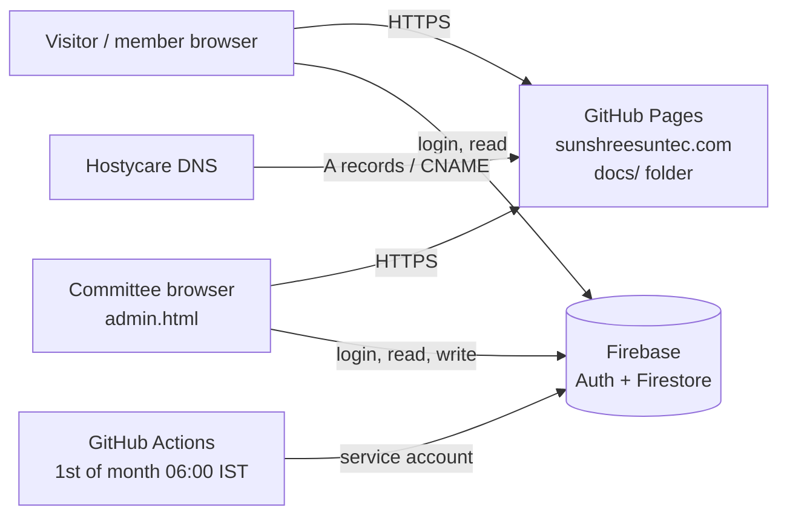

# Sunshree Suntec CHS – Website and Accounts: How It Works

**Society:** Sunshree Suntec Co-operative Housing Society Ltd., Sr. No. 19/2, 20/1, NIBM Road, Kondhwa Khurd, Pune 411048. Reg. No. PNA/PNA(4)/HSG/(TC)/12471/2012-13 dated 30/10/2012.
**Website:** https://sunshreesuntec.com
**Accounts:** https://sunshreesuntec.com/admin.html
**Software version:** see `CHANGELOG.md` (this document describes version 2.6.2).

This document explains what the system does, where the data lives, how every amount on a bill is calculated, who can see or change what, and how to answer common questions from members, auditors and the Registrar's office.

---

## Contents

1. Overview
2. Who uses what
3. How the system is built
4. Data: what is stored where
5. Security: who can read and change what
6. Bills: heads and numbering
7. How each charge is calculated
8. Payments, receipts and interest
9. Lift charges and lift expenses
10. Corrections and opening balances
11. The public dues page
12. Member access
12A. Staff: roles, access and agreement
13. Monthly and yearly procedures
14. Audit trail and records
15. Backups and exports
16. Setting up from scratch
17. Troubleshooting
18. Questions members ask
19. Legal references
20. Glossary

---

## 1. Overview

The system has three parts:

| Part | Address | For |
|---|---|---|
| Public website | sunshreesuntec.com | Everyone: notices, committee, contact, unit-wise maintenance dues |
| Member login | sunshreesuntec.com → Member login | Approved members: their own bills, receipts and account |
| Accounts | sunshreesuntec.com/admin.html | Managing committee: bills, payments, receipts, units, lift expenses, member approvals, website content, settings |

Everything that changes money (a bill, a payment, a cancelled receipt, a correction) updates three things together in one database transaction: the unit's **ledger**, the unit's **balance**, and the **public dues page**. They cannot drift apart.

---

## 2. Who uses what

| Role | How they get access | What they can do |
|---|---|---|
| Visitor | Nobody needs to log in | See dues by name and amount, notices, committee, contact |
| Member | Registers on the website with Google or email and password, adds name, unit and mobile; committee approves | See their own unit's balance, bills, receipts and ledger; download PDFs |
| Committee | Firebase account whose User UID is in the `admins` collection (record without `kind: 'staff'`) | Everything in admin.html |
| Staff (Accountant, Society Manager, Office Assistant) | Invited by the committee in the Staff tab; signs in with Google; accepts the agreement | Only the permissions given to them (section 12A) |
| GitHub Actions | Service account key stored as repository secret `FIREBASE_SERVICE_ACCOUNT` | Creates the month's bills at 06:00 IST on the 1st |

---

## 3. How the system is built

| Piece | What it does | Cost |
|---|---|---|
| GitHub repository `ChanchalSakardeQH/sunshreesuntec.com` | Holds all code; `docs/` is the website | Free (public repo) |
| GitHub Pages | Serves the website from `main` / `docs` | Free |
| Hostycare | Domain registration and DNS for sunshreesuntec.com | Domain fee |
| Firebase project `sunshreesuntec-74743` | Logins (Authentication) and data (Cloud Firestore, Mumbai) | Free Spark plan |
| GitHub Actions | Monthly bill run (`.github/workflows/monthly-bills.yml`) | Free for public repos |

### Code layout

| File | Purpose |
|---|---|
| `docs/index.html`, `assets/js/app.js` | Public website, tabs, dues tables, notices, committee, contact |
| `docs/assets/js/member.js` | Member registration, login, member account |
| `docs/admin.html`, `assets/js/admin.js` | Committee accounts screens |
| `docs/assets/js/accounts.js` | Every write that touches money (bills, payments, cancellations, corrections, lift expenses, import) |
| `docs/assets/js/billing-core.js` | **All billing rules**: bill heads, formulas, numbering, amount in words. Shared with the GitHub Action, so manual and automatic bills are identical |
| `docs/assets/js/defaults.js` | Starting values: society and bank details, AGM 2015 rates, MMC expense template, October 2026 bill |
| `docs/print.html`, `assets/js/print.js` | Printable bill and receipt (A4, Society format) |
| `docs/assets/js/firebase-config.js` | Firebase project settings (public values; access is controlled by the rules) |
| `docs/data/dues.json` | Statement balances as on 30 Sep 2026 (used for the one-time import and as a fallback) |
| `firestore.rules` | Server-side security rules |
| `scripts/generate-bills.mjs` | Monthly bill run used by GitHub Actions |

---

## 4. Data: what is stored where

All data is in Cloud Firestore. Amounts are whole rupees.

| Collection / document | Contents | Written by |
|---|---|---|
| `units/{unitId}` | Unit no., block, member name, premises type, charge category, status, lift (C / D / none), carpet area, inlets, vehicles, construction cost, BPM, **balance**, unpaid interest, per-unit overrides, active flag | Committee |
| `units/{unitId}/ledger/{entry}` | Every debit and credit: opening balance, bill, payment, cancellation, correction. Date, particulars, receipt no., debit, credit, kind, reference, who and when | Committee, GitHub Action |
| `bills/{unitId_YYYY-MM}` | One bill per unit per month: bill no., dates, period, arrears, each line with amount and calculation note, total, lift notes, method used | Committee, GitHub Action |
| `payments/{id}` | Receipts: receipt no., date, unit, amount, mode, reference, bank, against bill, balance before and after, interest cleared, status (ok / cancelled), who and when | Committee |
| `liftExpenses/{id}` | Lift AMC / repair expenses: lift, type, description, vendor, invoice, amount, start month, instalments, list of units sharing it | Committee |
| `counters/receipts-{FY}` | Next receipt serial for that financial year | Committee (inside the payment transaction) |
| `settings/billing` | Charge basis, AGM categories, MMC inputs, interest %, non-occupancy %, sinking / repairs %, lift billing, due days, last billed month | Committee, GitHub Action |
| `public/dues` | Names and balances shown on the public dues page | Committee, GitHub Action |
| `public/site` | Society and bank details, committee, contact, notices, basis-of-charges text | Committee |
| `users/{uid}` | Member access requests: name, unit, mobile, email, status (pending / approved / rejected) | Member (create), Committee (decide) |
| `admins/{uid}` | Committee members (no `kind`) and staff (`kind: 'staff'`, role, permissions, active, agreement version and acceptance, last sign-in) | First committee member: Firebase console. Staff: created when they claim their invitation. Committee: Staff tab |
| `staffInvites/{email}` | Invitations: name, mobile, role, permissions, who invited, when | Committee |
| `staffAgreements/{id}` | Permanent acceptance record: name signed, email, role, permissions, agreement version and title, date-time, device | Staff member (create only; never changed or deleted) |
| `settings/staffAgreement` | Current agreement: title, introduction, role responsibilities, commitments, closing, version, published by / on | Committee |

Unit IDs: `A-100`, `C-402`, `D-101A`, `GF-05`, `B-01` and so on. 65 units: A wing 4, C wing 16, D wing 4, Upper Ground Floor shops 20, Lower Basement shops 21 (as in the PMC-approved plan).

---

## 5. Security: who can read and change what

Enforced by `firestore.rules` on Google's servers, not just by the web pages. Committee members have every permission. Staff have only the permissions given to them, and only after accepting the current agreement; a suspended account has none.

| Data | Read | Create / change |
|---|---|---|
| `public/dues` | Anyone | Committee; staff with a money permission or *edit units* |
| `public/site` | Anyone | Committee; staff with *website* |
| `units` | *view* permission; approved member (own unit, confirmed email) | Committee: all fields. Money permissions: balance fields only. *Edit units*: name, type, status, area, inlets, vehicles, lift only |
| `units/…/ledger` | *view*; approved member (own unit) | Created by money operations; **never changed or deleted** |
| `bills` | *view*; approved member (own unit) | Created with *generate bills*; **never changed or deleted** |
| `payments` | *view*; approved member (own unit) | Created with *record payments*; only marked cancelled with *cancel receipts*; **never deleted** |
| `counters` | *record payments* | *record payments* (inside the payment) |
| `liftExpenses` | *view* | Added / deleted (before billing) with *lift expenses* |
| `settings/billing` | *view* | Committee; *generate bills* may update only the last-billed month |
| `settings/staffAgreement` | Committee and staff | Committee |
| `users` (member requests) | The member; *approve members* | Member creates own request (pending, valid mobile, own email); *approve members* decides |
| `admins` | Self; committee | Committee; a staff member may create their own record only from a matching invitation (same role and permissions, confirmed email) and may update only their agreement acceptance and last sign-in |
| `staffInvites` | Committee; the invited email | Committee |
| `staffAgreements` | Committee; the staff member's own record | The staff member, once per acceptance; **never changed or deleted** |

## 6. Bills: heads and numbering

### Bill heads (printed order)

| # | Head | Notes |
|---|---|---|
| 1 | Maintenance / Service Charges | AGM category amount, or equal share of common expenses (MMC) |
| 2 | Sinking Fund | 0.25% p.a. of construction cost |
| 3 | Repairs & Maintenance Fund | 0.75% p.a. of construction cost |
| 4 | Non-Occupancy Charges | 10% of service charges, let-out units |
| 5 | Arrears | Balance before this bill (negative = credit) |
| 6 | Penal Interest On Arrears | Simple interest, if a rate is set (max 12%) |
| 7 | Water Charges | Category amount, or per inlet (MMC) |
| 8 | Lift Charges | Yearly AGM amount, or monthly share (MMC); only units served by a lift |
| 9 | Vehicle Parking Charges | Vehicles × rate |
| 10 | Transfer Premium | One-off |
| 11 | Transfer Fee | One-off |
| 12 | Entrance Fee | One-off |
| 13 | Education & Training Fund | ₹10 per unit per month (AGM method) |
| 14 | Co-op Federation Fund | |
| 15 | Cheque Return Charges | One-off |
| 16 | Penalty / Other Charges | One-off; penalty max ₹5,000 a year |
| 17 | Any Others Charges | One-off (e.g. ₹6,500 in October 2026) |
| — | Optional, printed only when used | Lift AMC / Repairs (shared), Property Tax, Insurance Charges, Election Fund, Major Repairs Fund, Welfare Fund (voluntary), Loan Instalment & Interest, Lease Rent / N.A. Tax |

**Total** = Arrears + all current-month lines. Each line may carry a note showing how it was calculated.

### Numbering

| Document | Format | Example |
|---|---|---|
| Bill | Unit without spaces / bill date DDMMYYYY | `C402/01112026` |
| Receipt | SS / financial year / 4-digit serial, restarting each 1 April | `SS/2026-27/0001` |

A bill exists at most once per unit per month (document ID `C-402_2026-11`). Running bill generation again, by hand or by GitHub, only creates bills that are missing.

---

## 7. How each charge is calculated

The committee chooses the **charge basis** in Settings. Every bill records which basis was used.

### 7.1 AGM 2015 method (default)

Rates per **charge category**, from the AGM of 25 Jan 2015 as amended on 07 Jul 2015, effective 1 April 2015:

| Category | Maintenance (₹/month) | Water (₹/month) | Lift (₹/year) |
|---|---|---|---|
| Residential flat (A & C wing) | 1,300 | – | 1,000 |
| Residential flat used as commercial (A & C wing) | 2,000 | 300 | 2,000 |
| Commercial D wing (Gym D 201) | 2,000 | 500 | – |
| Commercial D wing clinic / hospital (D 101 A & B) | 2,000 | 500 | – |
| Shop without water | 1,000 | – | – |
| Shop with only water tap | 1,000 | 300 | – |
| Shop: beauty parlour / pet shop / clinic / food shop / chicken centre | 1,000 | 500 | – |

Plus Education & Training Fund ₹10 per unit per month. Lift is charged only if the unit is served by a lift; by default the yearly amount is billed in April.

Starting categories: A & C wing residential → Residential flat; A 100, A 101, A 102, C 100, C 102 → Used as commercial; D 101 A / B → Clinic; D 201, D 202 → Commercial D wing; all shops → Shop without water (to be adjusted per shop).

### 7.2 Monthly Maintenance Calculation (MMC) – Bye-laws 65–71, Rule 106C-12

| Head | Formula |
|---|---|
| Service charges | Σ monthly common expenses marked “All units” ÷ number of active units |
| Lift | Σ monthly lift expenses of that lift ÷ units served by that lift (+ “all lift units” items ÷ all lift units). Shops / units without lift pay none |
| Water | round(monthly water expense ÷ total inlets) × inlets of the unit |
| Property tax | Yearly tax × unit carpet area ÷ total carpet area ÷ 12 (only if the society pays it) |
| Insurance | Yearly premium × unit carpet area ÷ total carpet area ÷ 12 |

Worked example (sample figures): common expenses ₹47,650 ÷ 65 units = ₹733; C lift ₹4,800 ÷ 16 = ₹300; water ₹9,000 ÷ 116 inlets = ₹78 per inlet, a flat with 4 inlets pays ₹312.

### 7.3 Common to both methods

| Head | Formula |
|---|---|
| Construction cost | Amount entered on the unit, else cost per sq ft × carpet area |
| Repairs & maintenance fund | Construction cost × 0.75% ÷ 12 (e.g. ₹2,000 × 524 sq ft × 0.75% ÷ 12 = ₹655) |
| Sinking fund | Construction cost × 0.25% ÷ 12 (same example = ₹218) |
| Non-occupancy | Service charges × 10%, units with status Rented or Tenant |
| Parking | Two-wheelers × rate + four-wheelers × rate |
| Welfare fund | Voluntary amount set on the unit |
| Penal interest | See 8.3 |

**Overrides:** any head can be fixed for one unit (Units → Open → “Amounts for this unit only”). An override always wins over the category or calculation.

**Rounding:** every line is rounded to the nearest rupee. Society-wide totals collected can differ from expenses by a few rupees because of rounding.

### Carpet area and its source
- Carpet area drives the sinking fund, repairs fund, property tax, insurance and major repairs shares. Each unit stores the area and its **source** (e.g. “Index II p. 12”, Agreement, Measured).
- `docs/data/index2.json` holds what was read from the Index II file: 31 units with carpet area are filled with one click (Units → Enter area… → Fill carpet areas from Index II). Built-up and saleable figures are not carpet and are never used automatically; get the carpet figure from the member's agreement.
- `docs/data/plan-areas.json` holds the carpet of all 41 shops and stores worked out from the dimensions on the PMC-approved plans (main room only). Use **Fill shops from approved plan**; the grid shows plan and Index II side by side and flags differences over 5%.
- Lofts and terraces are recorded separately in the Index II note and are **not** added to carpet area unless the General Body decides otherwise.
- Units without a carpet area pay no area-wise charges until one is entered.

### 7.4 One-off charges (Bills page)

Choose a head, amount, and how to charge it:
- **Same amount for each unit**
- **Total, divided equally** among units in scope
- **Total, by carpet area** (e.g. Major Repairs Fund)

Scope is all units or one block. A penalty above ₹5,000 per member is refused.

---

## 8. Payments, receipts and interest

### 8.1 Recording a payment
Payments → choose unit → date, amount, mode (NEFT, IMPS, UPI, Cheque, Cash, Demand Draft), UTR / cheque no. (required for non-cash), bank, against bill no. The system:
1. Takes the next receipt serial for the financial year.
2. Saves the receipt with balance before and after.
3. Adds a credit to the unit's ledger.
4. Reduces the unit's balance and updates the public dues page.

All four happen together or not at all.

### 8.2 Cancelling a receipt
Payments → Cancel (reason required, e.g. cheque bounced). The receipt stays in the register marked **Cancelled**; a reversal debit is added to the ledger; the balance goes back up. Receipts cannot be deleted.

### 8.3 Penal interest
- Off until the committee sets a rate (Settings). Maximum 12% simple per year.
- Monthly interest = (arrears − unpaid interest already billed) × rate ÷ 12. Interest is never charged on interest.
- A payment first clears unpaid interest, then principal. Cancelling the payment restores that interest.

---

## 9. Lift charges and lift expenses

- Each unit is served by the **C wing lift**, the **D wing lift** or **no lift** (Units → Open, or the Units grid).
- **Lift Charges** line: the yearly AGM amount (AGM method) or the monthly share of lift running costs (MMC method).
- **Lift AMC / Repairs (shared)** line: any AMC invoice, repair, wear & tear, parts or licence recorded in the **Lift** tab.
  - Shared equally by the units served by that lift (or both lifts), fixed when the expense is recorded.
  - Recovered from the chosen bill month in 1–24 instalments.
  - The bill prints the description, invoice, total, number of units, instalment and share.
  - Must be entered before that month's bills are generated; can be deleted only until it appears on a bill.

---

## 10. Corrections and opening balances

### Opening balances
Source: Sundry Debtors – Group Summary, 1 Apr 2018 to 30 Sep 2026 (closing balances), and the bills dated 01/10/2026.
- Opening balance on 30/09/2026 = statement closing balance (credit balances as negative).
- October 2026 bill for every unit: arrears + ₹6,500 “Any Others Charges”, bill no. `UNIT/01102026`, period 01 Apr 2018 – 30 Sep 2026.
- B 01: ₹2,06,500 from the October bill (the statement row was incomplete); BPM ₹24,800.
- A 100, C 100, D 202: no balance in the statement → opening ₹0, flagged **Under verification** until checked.
- Builder Pending Maintenance (BPM) is kept on the unit and shown separately; it is not part of the member's balance.

### Corrections
Units → Open → Add a correction: debit (adds to dues) or credit (reduces dues), with date and particulars. Use for verified opening balances, waived amounts approved by the committee, or entries made against the wrong unit. Tick **Opening balance is now verified** to remove the flag.

---

## 11. The public dues page

- Shows every unit with member name, premises, **member outstanding** (balance today) and **BPM**, grouped by wing and shop floor, with search.
- Data comes from `public/dues`, rewritten in the same transaction as every bill, payment, cancellation and correction. If Firebase is unreachable, the page shows the 30 Sep 2026 statement from `data/dues.json`.
- “Cr” means the member has paid in advance. “Under verification” means the opening balance is still being checked.

---

## 12. Member access

1. Member opens Member login and either chooses **Continue with Google** or registers with email and password.
2. Member enters full name, unit, 10-digit mobile number and confirms they own or represent the unit. (Google sign-in fills the name and the email is already confirmed; email-and-password members confirm the email link.)
3. Committee (or staff with *approve members*) approves in Members after checking the member register. Requests made with Google are marked “Google”. A warning shows if someone is already approved for that unit.
4. Member sees their balance, bills, receipts and ledger, and can download PDFs.

Rejected or removed members lose access immediately. Google sign-in requires **Authentication → Sign-in method → Google** to be enabled in Firebase.

## 12A. Staff: roles, access and agreement

### Adding staff (committee)
Accounts → **Staff** → Add staff: full name, Gmail address, mobile, role, and access (pre-ticked by role, can be changed). The person opens sunshreesuntec.com/admin.html, chooses **Continue with Google** with that Gmail, reads the agreement, ticks acceptance, types their full name, and starts work.

### Permissions

| Permission | Allows | Accountant | Society Manager | Office Assistant |
|---|---|---|---|---|
| View accounts | Dashboard, units, bills, receipts, ledgers, lift expenses | Yes | Yes | Yes |
| Record payments | Save payments, issue receipts | Yes | Yes | Yes |
| Cancel receipts | Mark a receipt cancelled with reason | Yes | – | – |
| Generate bills | Create the month's bills | Yes | – | – |
| Corrections | Debit / credit entries on a unit | Yes | – | – |
| Edit units | Name, type, status, area, inlets, vehicles, lift (not amounts) | – | Yes | – |
| Lift expenses | Record lift AMC / repair expenses | Yes | Yes | – |
| Approve members | Approve / remove member logins | – | Yes | – |
| Website | Notices, committee and contact details | – | Yes | – |
| Committee only | Settings (rates, charge basis, society / bank details), opening import, staff, agreement | – | – | – |

Defaults are pre-ticked when inviting; the committee may give or withhold any permission per person.

### The agreement
The **Commitment, Confidentiality and Work Responsibilities Agreement** shows the staff member's name, role, contact, the exact access given (and what is committee-only), the responsibilities of the role, and the general commitments: use only for assigned work; own login only; confidentiality of member data, including under the Digital Personal Data Protection Act, 2023; no copying or forwarding of member data; true, complete, same-day entries backed by documents; no altering or back-dating (mistakes corrected by new entries); cash and cheques receipted immediately and deposited by the next working day; declaring personal interest; following bye-laws, resolutions and committee instructions; reporting errors or misuse; awareness that every action is recorded and access can be withdrawn; handover on leaving.

- Access starts only after acceptance. The acceptance is stored permanently (name signed, email, role, permissions, version, date-time, device) and listed in Staff → Acceptance record.
- The committee can edit the text and **Publish as new version**; every staff member must accept the new version at their next sign-in.
- Staff can read their accepted agreement and their access any time under **My profile**.
- The agreement text is a starting draft; the committee should review it (and take legal advice if needed) before relying on it.

### Changing or ending access
Staff → Edit: change role or permissions, untick **Access active** to suspend, or **Remove access** (removes the login's access and the invitation; their past entries and agreement record remain).

## 13. Monthly and yearly procedures

### Every month
1. Before the 1st: record lift expenses for the coming month (Lift tab); check new tenants (status Rented / Tenant) and vehicle changes.
2. 1st, 06:00 IST: GitHub creates the bills (or Bills → Generate bills).
3. Bills → **Print all bills** → save one PDF; distribute.
4. Through the month: record every payment the day it reaches the bank; send receipts.
5. Month end: Payments → **Download CSV**; reconcile with the IDBI bank statement.

### Every year
- April: yearly lift charge (AGM method) is billed automatically; receipt numbers restart (`SS/2027-28/0001`).
- Before the AGM: Settings → Preview next month's bills → CSV for the General Body; update rates and expenses after the AGM resolution; record the resolution date in **Basis of charges**.
- Update the committee on the Website tab after elections.

---

## 14. Audit trail and records

| Record | What is kept |
|---|---|
| Every ledger entry | Date, particulars, receipt no., debit, credit, kind, reference to bill or payment, user ID, server timestamp |
| Every bill | Exact lines and notes as issued, method used, who created it (committee user ID or `github-actions`), when |
| Every receipt | Who recorded it, when, balance before and after; cancellation reason, who and when |
| Lift expenses | Invoice details, units sharing, who recorded it |
| Member approvals | Who approved / rejected and when |
| Settings | `lastRun` (month, time, count, by) and `lastBilledMonth` |

Bills keep the amounts they were issued with, even if rates change later. Receipts cannot be deleted.

---

## 15. Backups and exports

- Monthly: Payments → Download CSV; Bills → Print all bills (PDF).
- Before the AGM: Settings → Preview → Download CSV.
- Full export: Firebase console → Firestore → Import/Export needs the paid Blaze plan; on the free plan, keep the monthly CSV and PDF files in the society's Google Drive.
- Code: every change is in GitHub history; `CHANGELOG.md` lists what changed and when.

---

## 16. Setting up from scratch

See `README.md` for step-by-step instructions. Summary:
1. GitHub repo → Settings → Pages → `main` / `docs`; custom domain; Hostycare DNS (four A records 185.199.108–111.153, `www` CNAME `chanchalsakardeqh.github.io`).
2. Firebase: Email/Password sign-in; authorised domains (sunshreesuntec.com, www.sunshreesuntec.com, chanchalsakardeqh.github.io); Firestore in asia-south1; publish `firestore.rules`.
3. `docs/assets/js/firebase-config.js`: only the `export const firebaseConfig = {…}` block.
4. Create committee users; add each UID to `admins`.
5. admin.html → Settings → Import opening balances (once).
6. GitHub secret `FIREBASE_SERVICE_ACCOUNT` for the monthly run.

---

## 17. Troubleshooting

| Symptom | Cause | Fix |
|---|---|---|
| Pages stuck on “Loading…”, tabs don't switch | Error in `firebase-config.js` (e.g. pasted `import … from "firebase/app"`) | Keep only the `export const firebaseConfig` block. Press F12 → Console to see the red error |
| Unit drop-downs empty | Opening balances not imported | Settings → Import opening balances |
| “This action isn't allowed for your account” | Rules not published, or your UID not in `admins` | Publish `firestore.rules`; add UID to `admins` |
| “Bills up to … are already generated” on a lift expense | That month is billed | Start recovery from the next month |
| Member says they can't see their account | Not approved, or email not confirmed | Members tab; ask them to click the email link and “I've confirmed my email” |
| GitHub monthly run failed | Missing or wrong secret, or workflow paused after 60 days without commits | Actions tab → read the log; re-add secret; Enable workflow; or generate from Bills |
| Website shows old README instead of site | Pages source not set to `/docs` | Settings → Pages → folder `/docs` |
| “Google sign-in isn't switched on yet” | Google provider disabled | Firebase → Authentication → Sign-in method → Google → Enable |
| “This website address isn't authorised for sign-in” | Domain missing | Firebase → Authentication → Settings → Authorized domains |
| Staff member: “isn't a committee or staff account” | Signed in with a different Gmail than invited, or invitation cancelled | Sign in with the invited Gmail; check Staff → Invitations |
| Staff member stuck on the agreement | New version published | Read, tick, sign, accept |
| Staff member gets “This action isn't allowed” | That permission isn't given, or access suspended | Staff → Edit |

---

## 18. Questions members ask

**How was my bill calculated?** Open the bill: every line shows its note (e.g. “Equal to all 65 units”, “4 inlets × ₹78”, “10% of service charges”). The basis line at the bottom names the AGM resolution or the bye-laws and rules used. Settings → Preview shows the same calculation for every unit.

**Why does my balance differ from my own records?** The ledger (My account → Account entries) lists every opening balance, bill, payment and correction since 30 Sep 2026. Bring receipts for any payment not shown; the committee adds a correction once verified.

**Why do I pay lift charges / why don't shops?** Lift costs are shared only by the units served by that lift, as the rules require. Shops and A wing have no lift.

**Why is my water charge different from my neighbour's?** Under the MMC method water is charged per inlet; under the AGM method by category (no water, tap only, heavy use).

**Is interest charged on interest?** No. Interest is simple, on unpaid principal only, maximum 12% p.a., and only if the General Body has fixed a rate.

**What is BPM?** Builder Pending Maintenance from the builder period, shown separately and not added to the member's balance.

**Who can see my mobile number and email?** The committee, and staff the committee has allowed to approve member logins, under a written confidentiality agreement. The public page shows names and amounts only.

**Who changed my account?** Every bill, payment, cancellation and correction is stored with the user who made it and the time, and none can be deleted; ask the committee for the entry details.

**What happens if my cheque bounces?** The receipt is cancelled (kept on record), the amount goes back on your account, and Cheque Return Charges may be added as fixed by the General Body.

---

## 19. Legal references

- Maharashtra Co-operative Societies Act, 1960 (Section 154B for housing societies).
- Maharashtra Co-operative Societies Rules, 1961, as amended by the MCS (Amendment) Rules, 2026 (notified 18 June 2026; Gazette 22 June 2026), Chapter XI-B, including Rule 106C-12 on charges.
- Model Bye-laws of Co-operative Housing Societies (2014): Bye-laws 13 (funds), 43 (non-occupancy), 65–71 (levy of charges, interest), 165 (penalty).
- Society resolutions: AGM 25 Jan 2015 (MOM AGM-MOM/20150225), amendment 07 Jul 2015 (AmendmentOfMom/20150707).
- Notice dated 16 Oct 2026 (payment and account verification).

The software applies the rates and options the committee enters. It does not decide what is legally required; rates must be approved by the General Body, and legal questions should go to the society's legal adviser or the Registrar's office.

---

## 20. Glossary

| Term | Meaning |
|---|---|
| Arrears | Balance before the current bill |
| BPM | Builder Pending Maintenance |
| Charge basis | AGM 2015 category rates or the Monthly Maintenance Calculation |
| Charge category | Group of units with the same AGM rates |
| Cr | Credit: the member has paid in advance |
| FY | Financial year, 1 April to 31 March |
| Inlet | Water connection / tap counted for water charges |
| Ledger | Running account of a unit |
| MMC | Monthly Maintenance Calculation as per the 2026 Rules |
| Override | Amount fixed for one unit that replaces the calculated amount |
| UTR | Unique transaction reference for NEFT / IMPS / UPI |
