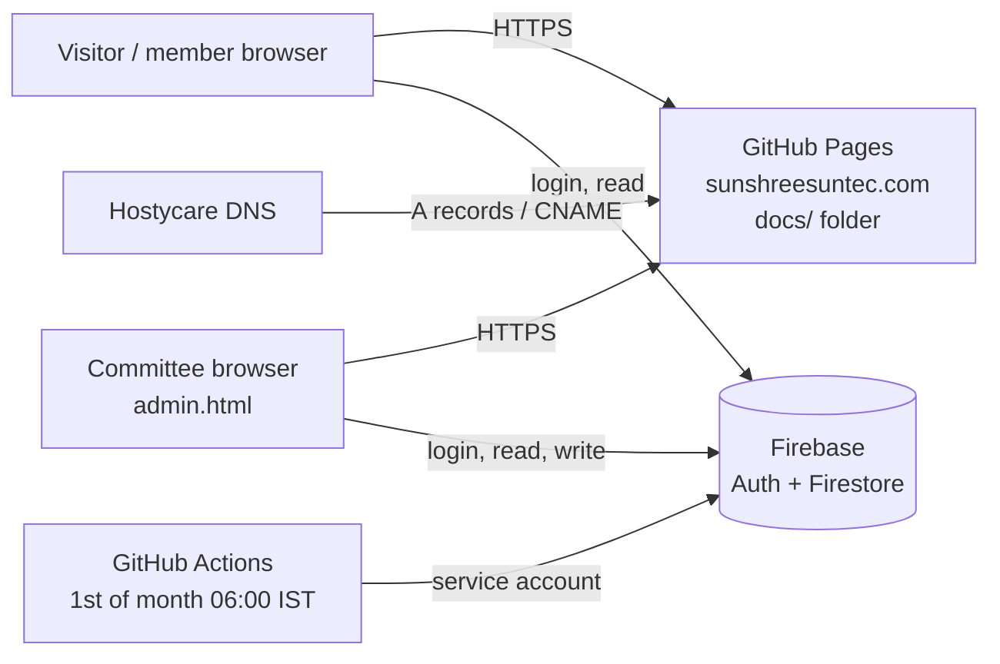

# Sunshree Suntec CHS – Website and Accounts: How It Works

**Society:** Sunshree Suntec Co-operative Housing Society Ltd., Sr. No. 19/2, 20/1, NIBM Road, Kondhwa Khurd, Pune 411048. Reg. No. PNA/PNA(4)/HSG/(TC)/12471/2012-13 dated 30/10/2012.
**Website:** https://sunshreesuntec.com
**Accounts:** https://sunshreesuntec.com/admin.html
**Software version:** see `CHANGELOG.md` (this document describes version 3.32.0).

This document explains what the system does, where the data lives, how every amount on a bill is calculated, who can see or change what, and how to answer common questions from members, auditors and the Registrar's office.

---

## Contents

1. Overview
2. Who uses what
3. How the system is built
4. Data: what is stored where
5. Security: who can read and change what
6. Bills: heads and numbering
7. How each charge is calculated
8. Payments, receipts and interest
9. Lift charges and lift expenses
10. Corrections and opening balances
11. The public dues page
11-1. Notices page
11A. Unit file
11B. Unit documents, electricity, property tax and backups
11C. Member portal agreement and members' documents
11D. Correspondence register
11E. Committee list
11F. Penal interest: rate periods and interest on past arrears
12. Member access
12-1. Reminders and invitations (3.16)
12-2. Registrations not finished (3.17)
12-3. Other units' amounts and the Society's accounts: permissions and applications (3.18)
12-4. Managing Committee: posts, undertaking and M-20 bonds (3.19)
12-5. Rules, GRs and forms library (3.20)
12-6. Test copy for trying roles safely (3.21)
12-7. Pre-registering members by email (3.22)
12-8. Membership transfer documents: death and sale (3.23)
12-9. Bye-law forms and "Which forms do I need?" (3.24)
12A. Staff: roles, access and agreement
12A-2. Tally ledger history (2018–2026)
12A-3. Audited accounts 2011-12 to 2017-18 and documents
12A-4. Past committee's receipts (2011–2016)
12B. Financial year and reports
12C. Android app
13. Monthly and yearly procedures
14. Audit trail and records
15. Backups and exports
16. Setting up from scratch
17. Troubleshooting
18. Questions members ask
19. Legal references
20. Glossary

---

## 1. Overview

The system has three parts:

| Part | Address | For |
|---|---|---|
| Public website | sunshreesuntec.com | Everyone: notices, committee, contact, unit-wise maintenance dues |
| Member login | sunshreesuntec.com → Member login | Approved members: their own bills, receipts and account |
| Accounts | sunshreesuntec.com/admin.html | Managing committee: bills, payments, receipts, units, lift expenses, member approvals, website content, settings |

Everything that changes money (a bill, a payment, a cancelled receipt, a correction) updates three things together in one database transaction: the unit's **ledger**, the unit's **balance**, and the **public dues page**. They cannot drift apart.

---

## 2. Who uses what

| Role | How they get access | What they can do |
|---|---|---|
| Visitor | Nobody needs to log in | See dues by name and amount, notices, committee, contact |
| Member | Registers on the website with Google or email and password, adds name, unit and mobile; committee approves | See their own unit's balance, bills, receipts and ledger; download PDFs |
| Committee | Firebase account whose User UID is in the `admins` collection (record without `kind: 'staff'`) | Everything in admin.html |
| Staff (Accountant, Society Manager, Office Assistant) | Invited by the committee in the Staff tab; signs in with Google; accepts the agreement | Only the permissions given to them (section 12A) |
| GitHub Actions | Service account key stored as repository secret `FIREBASE_SERVICE_ACCOUNT` | Creates the month's bills at 06:00 IST on the 1st |

---

## 3. How the system is built

| Piece | What it does | Cost |
|---|---|---|
| GitHub repository `ChanchalSakardeQH/sunshreesuntec.com` | Holds all code; `docs/` is the website | Free (public repo) |
| GitHub Pages | Serves the website from `main` / `docs` | Free |
| Hostycare | Domain registration and DNS for sunshreesuntec.com | Domain fee |
| Firebase project `sunshreesuntec-74743` | Logins (Authentication) and data (Cloud Firestore, Mumbai) | Free Spark plan |
| GitHub Actions | Monthly bill run (`.github/workflows/monthly-bills.yml`) | Free for public repos |

### Code layout

| File | Purpose |
|---|---|
| `docs/index.html`, `assets/js/app.js` | Public website, tabs, dues tables, notices with calendar, committee, contact |
| `docs/assets/js/member.js` | Member registration, login, member account |
| `docs/admin.html`, `assets/js/admin.js` | Committee accounts screens |
| `docs/assets/js/accounts.js` | Every write that touches money (bills, payments, cancellations, corrections, lift expenses, import) |
| `docs/assets/js/billing-core.js` | **All billing rules**: bill heads, formulas, numbering, amount in words. Shared with the GitHub Action, so manual and automatic bills are identical |
| `docs/assets/js/defaults.js` | Starting values: society and bank details, AGM 2015 rates, MMC expense template, October 2026 bill |
| `docs/print.html`, `assets/js/print.js` | Printable bill and receipt (A4, Society format) |
| `assets/js/notices.js` (3.28) | Demand / recovery notices: the bilingual letter filled in per unit |
| `assets/js/sitepause.js`, `assets/css/pause.css` (3.28) | The *website under maintenance* page when the website is paused |
| `assets/js/billexplain.js` (3.27) | The page printed after a bill: *How this bill is worked out* (charges, interest, arrears year by year) |
| `docs/assets/js/firebase-config.js` | Firebase project settings (public values; access is controlled by the rules) |
| `docs/data/dues.json` | Statement balances as on 30 Sep 2026 (used for the one-time import and as a fallback) |
| `firestore.rules` | Server-side security rules |
| `scripts/generate-bills.mjs` | Monthly bill run used by GitHub Actions |

---

## 4. Data: what is stored where

All data is in Cloud Firestore. Amounts are whole rupees.

| Collection / document | Contents | Written by |
|---|---|---|
| `units/{unitId}` | Unit no., block, member name, premises type, charge category, status, lift (C / D / none), carpet area, inlets, vehicles, construction cost, BPM, **balance**, unpaid interest, per-unit overrides, active flag | Committee |
| `units/{unitId}/ledger/{entry}` | Every debit and credit: opening balance, bill, payment, cancellation, correction. Date, particulars, receipt no., debit, credit, kind, reference, who and when | Committee, GitHub Action |
| `bills/{unitId_YYYY-MM}` | One bill per unit per month: bill no., dates, period, arrears, each line with amount and calculation note, total, lift notes, method used | Committee, GitHub Action |
| `payments/{id}` | Receipts: receipt no., date, unit, amount, mode, reference, bank, against bill, balance before and after, interest cleared, status (ok / cancelled), who and when | Committee |
| `liftExpenses/{id}` | Lift AMC / repair expenses: lift, type, description, vendor, invoice, amount, start month, instalments, list of units sharing it | Committee |
| `counters/receipts-{FY}` | Next receipt serial for that financial year | Committee (inside the payment transaction) |
| `settings/billing` | Charge basis, AGM categories, MMC inputs, interest %, non-occupancy %, sinking / repairs %, lift billing, due days, last billed month | Committee, GitHub Action |
| `public/dues` | Names and balances shown on the public dues page | Committee, GitHub Action |
| `public/site` | Society and bank details, committee, contact, notices, basis-of-charges text | Committee |
| `users/{uid}` | Member access requests: name, unit, mobile, email, `relation` (owner / jointOwner / family / tenant / caretaker), `access` (full / basic, set by the committee), status (pending / approved / rejected), `removed` (true when an approved member's access was removed), `reason` (shown to the member), `decidedAt`, `decidedBy`, `decidedByEmail` | Member (create), Committee (decide) |
| `users/{uid}` (3.16–3.18) | Also: `lastSeenAt` (the member's last visit, at most once a day); `seeAllDues` (may see other units' maintenance amounts); `societyAccounts` and `accountsUntil` (may see the Society's audited accounts and documents, until that date if set); `accessBy`, `accessByName`, `accessAt` (who last changed these and when) | Member (`lastSeenAt` only); Chairman, Secretary, Treasurer or Accountant (the view permissions) |
| `accessRequests/{uid}_{time}` (3.18) | Members' applications to view the Society's accounts: member, unit, email, mobile, relation, what (`accounts`, `allDues`), purpose, status (pending / approved / rejected / withdrawn), what was given (`granted`), until, reason, who decided (name, role) and when, whether it was emailed to the Society. Never deleted | Member (create, withdraw); Chairman, Secretary, Treasurer or Accountant (decide) |
| `memberReminders/{id}` (3.16) | Every reminder or invitation sent: kind (agreement / visit / invite / unfinished), person, unit, email, mobile, channel (WhatsApp / email / email from the Society), who and when. Never changed | Members tab |
| `settings/memberReminders` (3.16) | The committee's wording of each reminder | Committee |
| `units/{unitId}/history/audited` (3.18) | That unit's own audited year-end figures (year, date, listed or not, name, amount), taken from the audit file so the member sees their history without the whole file | Committee's page, automatically when the audited years change (`settings/auditHistory`) |
| `admins/{uid}` committee fields (3.19) | `role` (post: Chairman, Vice-Chairman, Secretary, Joint Secretary, Treasurer, Committee member), `unit`, `unitLabel`, `tookOfficeOn`, `termEnds`, `termEndedOn`, `endReason`, `postHistory` (post, from, by, when), `undertakingVersion`, `undertakingAt`, `undertakingName`, `undertakingId`, `m20` (submittedOn, stampValue, stampNo, file, receivedBy, receivedByName) | Committee |
| `committeeUndertakings/{id}` (3.19) | Each acceptance of the committee undertaking with the exact text accepted (title, intro, the post's responsibilities, undertakings, closing), signed name, post, unit, date taking office, server time, device, PDF copy and whether emailed. Never deleted | The committee member (own); PDF fields by the committee |
| `settings/committeeUndertaking` (3.19) | Current committee undertaking (versioned; the standard text is used until one is published) | Committee |
| `settings/committeeRegister` (3.19) | Date the committee was formed, date the Registrar was informed, letter reference and copy | Committee |
| `libraryDocs/{id}` (3.20) | Library entry: title, category, issued by, number / reference, date, year, language, keywords, description, official source, public, the file in the Drive (id, name, type, size), words read and pages, removed, who added and changed it; for bye-law forms (3.24) `formKey` (e.g. appendix-15) and `guide` (no, aka, law, signedBy, stamp, use, attach) | Committee and staff with *library* |
| `libraryDocs/{id}/index/{n}` (3.20) | The words inside the document (space-separated, unique, lower case), in chunks of up to 700 KB, with the entry's public flag | Same |
| `units/{id}/transfers/{caseId}` (3.23) | A membership transfer of the unit: type (death / sale), the list of documents as it was when started (`items`: id, name, note, letter, libraryId), what was received (`got`: date or not needed, by whom), scans (`files` with the item they belong to), outgoing and new member(s), date of the deed or of death, deed no., possession date, share certificate no., committee resolution date and reference, certificate endorsed on, new certificate no., notes, status (open / completed / cancelled), who started and changed it | Read: *view* and the unit's approved members; write: *maintain unit files*; delete: committee |
| `paymentClaims/{id}` (3.29) | A payment reported by a unit's member: unit, uid, name, relation, email, date, amount, mode, reference, bank, paid by, bill no., note, proof files, status (submitted / query / verified / rejected / withdrawn), round, answer, decision (note, by, role, at), payment id and receipt no. when verified | Create: approved member of the unit; read: the reporter, the unit's full-access members, *view*; decide: *record payments* |
| `public/status` (3.28) | Website paused: paused, title / message (English, Marathi), until, at, by; resumedAt, resumedBy | Read: everyone; write: *website* permission |
| `noticeRuns/{id}` (3.28) | Demand / recovery notices prepared: subject (English, Marathi), letter date, reference, month of the bills enclosed, days, minimum dues, earlier notices, interest clauses, signer; units (unit, name, type, dues, bill no., date and total, registered post no.); recorded (unit → correspondence no.) | Read: *view*; write: *generate bills* or committee |
| `settings/fullBackup` (3.25) | Written by the storage script: last full backup (ok, kind, by, at, docs, users, bytes, file name, seconds, copies removed, records per collection), a failure (failedAt, error), the last restore | Read: *view*; written by the script with the Society account's access |
| `settings/fullBackupConfig` (3.25) | Schedule: frequency (daily, weekly, off), hour, weekday, keepDays | Read: *view*; write: committee |
| `settings/transferChecklists` (3.23) | The Society's two lists (death, sale): title, introduction and documents (name, note, Society letter, Library blank form, bye-law form key (3.24)) | Read: approved members and the team; write: committee |
| `memberInvites/{email}` (3.22) | Members pre-registered by the committee: email (lower case, the document id), unit, name, relation, access, mobile, status (open / used / cancelled), who and when, who used it and when | *approve members*; the person themselves marks it used |
| `memberLog/{id}` | History of decisions on member requests: user, action (approved / rejected / removed / restored / edited / notified), what changed, reason, committee note, who and when. Saved in one batch with the decision. Deleted only with its record, by the committee (*Delete permanently*) | Committee / staff with *approve members* (create) |
| `signInLog/{id}` | Every sign-in, registration and password-reset attempt, website and app: method, page, website or app (+ app version), result (ok / cancelled / failed), error code and detail (for the app: the app's signing SHA-1), email when known, phone or browser, seconds taken, server time; and (3.17) the name, unit and mobile typed in the registration form when Google was opened from it. Never passwords or tokens | The sign-in screens (create only, strict fields); committee may delete |
| `admins/{uid}` | Committee members (no `kind`) and staff (`kind: 'staff'`, role, permissions, active, `agreementRequired` (false = no agreement needed, e.g. auditors), `validUntil` (access ends after this date), `org`, agreement version and acceptance, last sign-in) | First committee member: Firebase console. Staff: created when they claim their invitation, or by the committee approving a request. Committee: Staff tab |
| `expenses/{id}` | Daily expenses: date, month, FY, amount, head, paid to, bill no., description, who paid (`society` with mode and reference / `person` with name / `unpaid`), bill files (Drive file ids and names), status (submitted / approved / rejected), voucher number, reason, who added / decided and when, payment date (vendor paid later), payback link (`settlementId`, `settledOn`) | Staff with *Add expenses* (own), approvers, payers |
| `expenses/{id}/log/{id}` | Step-by-step history of each expense (added, corrected, approved, rejected, paid, paid back). Never changed | The accounts pages |
| `staffSettlements/{id}` | Paybacks (with the expenses they cover, any advance set against them) and advances to staff: number (PB/ADV/FY/nnnn), person, amount, date, mode, reference | Staff with *Record expense payments* |
| `settings/files` | Address of the bill storage script | Committee |
| `staffRequests/{uid}` | Staff and officials asking for access from the registration form: name, role, organisation, mobile, email, status (pending / approved / rejected), reason, who decided and when | The person (create, own only); committee (decide) |
| `settings/rolePolicies` | Access by role: for each role its permissions, whether the agreement is required, and how many days access lasts | Committee |
| `staffInvites/{email}` | Invitations: name, mobile, role, permissions, who invited, when | Committee |
| `staffAgreements/{id}` | Permanent acceptance record: name signed, email, role, permissions, agreement version and title, date-time, device | Staff member (create only; never changed or deleted) |
| `settings/staffAgreement` | Current agreement: title, introduction, role responsibilities, commitments, closing, version, published by / on | Committee |

Unit IDs: `A-100`, `C-402`, `D-101A`, `GF-05`, `B-01` and so on. 65 units: A wing 4, C wing 16, D wing 4, Upper Ground Floor shops 20, Lower Basement shops 21 (as in the PMC-approved plan).

---

## 5. Security: who can read and change what

Enforced by `firestore.rules` on Google's servers, not just by the web pages. Committee members have every permission. Staff have only the permissions given to them, and only after accepting the current agreement; a suspended account has none.

| Data | Read | Create / change |
|---|---|---|
| `public/dues` | Anyone | Committee; staff with a money permission or *edit units* |
| `public/site` | Anyone | Committee; staff with *website* |
| `units` | *view* permission; approved member (own unit, confirmed email) | Committee: all fields. Money permissions: balance fields only. *Edit units*: name, type, status, area, inlets, vehicles, lift only |
| `units/…/ledger` | *view*; approved member (own unit) | Created by money operations; **never changed or deleted** |
| `bills` | *view*; approved member (own unit) | Created with *generate bills*; **never changed or deleted** |
| `payments` | *view*; approved member (own unit) | Created with *record payments*; only marked cancelled with *cancel receipts*; **never deleted** |
| `auditLog` (activity trail, 3.34) | Committee; staff given *See the activity trail* | Created by the person making a money change, in the same commit (own uid, server time, fixed fields); **never changed or deleted** |
| `settings/audit` (3.34) | *view* | Committee. When `required` is true, a change to a unit's `balance` / `interestDue` must set `auditId` to a new `auditLog` entry by the same person for that unit (`balanceAudited()`) |
| `counters` | *record payments* | *record payments* (inside the payment) |
| `liftExpenses` | *view* | Added / deleted (before billing) with *lift expenses* |
| `settings/billing` | *view* | Committee; *generate bills* may update only the last-billed month |
| `settings/staffAgreement` | Committee and staff | Committee |
| `private/dues` (real amounts of all units) | *view*; an approved member given *Maintenance amounts of all units* (3.18) | Money operations |
| `auditYears`, `archiveDocs` (audited accounts, Society documents) | *view*; an approved member given *The Society's audited accounts and documents*, before its end date (3.18) | Committee |
| `users` (member requests) | The member; *approve members*; the approvers | Member creates own request (pending, valid mobile, own email); *approve members* decides. The two view permissions (`seeAllDues`, `societyAccounts`, `accountsUntil`) only by the Chairman, Secretary, Treasurer or Accountant (3.18) |
| `accessRequests` (3.18) | The member (own); *approve members*; the approvers | Member creates own (own unit and email, fixed fields) and may withdraw while waiting; approvers decide; never deleted |
| `memberReminders` (3.16) | *approve members* | *approve members* (stamped); never changed |
| `admins` | Self; committee | Committee; a staff member may create their own record only from a matching invitation (same role and permissions, confirmed email) and may update only their agreement acceptance and last sign-in |
| `staffInvites` | Committee; the invited email | Committee |
| `staffAgreements` | Committee; the staff member's own record | The staff member, once per acceptance; **never changed or deleted** |

## 6. Bills: heads and numbering

### Bill heads (printed order)

| # | Head | Notes |
|---|---|---|
| 1 | Maintenance / Service Charges | AGM category amount, or equal share of common expenses (MMC) |
| 2 | Sinking Fund | 0.25% p.a. of construction cost |
| 3 | Repairs & Maintenance Fund | 0.75% p.a. of construction cost |
| 4 | Non-Occupancy Charges | 10% of service charges, let-out units |
| 5 | Arrears | Balance before this bill (negative = credit) |
| 6 | Penal Interest On Arrears | Simple interest, if a rate is set (max 12%) |
| 7 | Water Charges | Category amount, or per inlet (MMC) |
| 8 | Lift Charges | Yearly AGM amount, or monthly share (MMC); only units served by a lift |
| 9 | Vehicle Parking Charges | Vehicles × rate |
| 10 | Transfer Premium | One-off |
| 11 | Transfer Fee | One-off |
| 12 | Entrance Fee | One-off |
| 13 | Education & Training Fund | ₹10 per unit per month (AGM method) |
| 14 | Co-op Federation Fund | |
| 15 | Cheque Return Charges | One-off |
| 16 | Penalty / Other Charges | One-off; penalty max ₹5,000 a year |
| 17 | Any Others Charges | One-off (e.g. ₹6,500 in October 2026) |
| — | Optional, printed only when used | Lift AMC / Repairs (shared), Property Tax, Insurance Charges, Election Fund, Major Repairs Fund, Welfare Fund (voluntary), Loan Instalment & Interest, Lease Rent / N.A. Tax |

**Total** = Arrears + all current-month lines. Each line may carry a note showing how it was calculated.

### Numbering

| Document | Format | Example |
|---|---|---|
| Bill | Unit without spaces / bill date DDMMYYYY | `C402/01112026` |
| Receipt | SS / financial year / 4-digit serial, restarting each 1 April | `SS/2026-27/0001` |

A bill exists at most once per unit per month (document ID `C-402_2026-11`). Running bill generation again, by hand or by GitHub, only creates bills that are missing.

---

## 7. How each charge is calculated

The committee chooses the **charge basis** in Settings. Every bill records which basis was used.

### 7.1 AGM 2015 method (default)

Rates per **charge category**, from the AGM of 25 Jan 2015 as amended on 07 Jul 2015, effective 1 April 2015:

| Category | Maintenance (₹/month) | Water (₹/month) | Lift (₹/year) |
|---|---|---|---|
| Residential flat (A & C wing) | 1,300 | – | 1,000 |
| Residential flat used as commercial (A & C wing) | 2,000 | 300 | 2,000 |
| Commercial D wing (Gym D 201) | 2,000 | 500 | – |
| Commercial D wing clinic / hospital (D 101 A & B) | 2,000 | 500 | – |
| Shop without water | 1,000 | – | – |
| Shop with only water tap | 1,000 | 300 | – |
| Shop: beauty parlour / pet shop / clinic / food shop / chicken centre | 1,000 | 500 | – |

Plus Education & Training Fund ₹10 per unit per month. Lift is charged only if the unit is served by a lift; by default the yearly amount is billed in April.

Starting categories: A & C wing residential → Residential flat; A 100, A 101, A 102, C 100, C 102 → Used as commercial; D 101 A / B → Clinic; D 201, D 202 → Commercial D wing; all shops → Shop without water (to be adjusted per shop).

### 7.2 Monthly Maintenance Calculation (MMC) – Bye-laws 65–71, Rule 106C-12

| Head | Formula |
|---|---|
| Service charges | Σ monthly common expenses marked “All units” ÷ number of active units |
| Lift | Σ monthly lift expenses of that lift ÷ units served by that lift (+ “all lift units” items ÷ all lift units). Shops / units without lift pay none |
| Water | Monthly water expense ÷ number of units with Water usage = Yes (units marked No pay none) |
| Property tax | Yearly tax × unit carpet area ÷ total carpet area ÷ 12 (only if the society pays it) |
| Insurance | Yearly premium × unit carpet area ÷ total carpet area ÷ 12 |

Worked example (sample figures): common expenses ₹47,650 ÷ 65 units = ₹733; C lift ₹4,800 ÷ 16 = ₹300; water ₹9,000 ÷ 116 inlets = ₹78 per inlet, a flat with 4 inlets pays ₹312.

### 7.3 Common to both methods

| Head | Formula |
|---|---|
| Construction cost | Amount entered on the unit, else cost per sq ft × carpet area |
| Repairs & maintenance fund | Construction cost × 0.75% ÷ 12 (e.g. ₹2,000 × 524 sq ft × 0.75% ÷ 12 = ₹655) |
| Sinking fund | Construction cost × 0.25% ÷ 12 (same example = ₹218) |
| Non-occupancy | Service charges × 10%, units with status Rented or Tenant |
| Parking | Two-wheelers × rate + four-wheelers × rate |
| Welfare fund | Voluntary amount set on the unit |
| Penal interest | See 8.3 |

**Overrides:** any head can be fixed for one unit (Units → Open → “Amounts for this unit only”). An override always wins over the category or calculation.

**Rounding:** every line is rounded to the nearest rupee. Society-wide totals collected can differ from expenses by a few rupees because of rounding.

### Carpet area and its source
- Carpet area drives the sinking fund, repairs fund, property tax, insurance and major repairs shares. Each unit stores the area and its **source** (e.g. “Index II p. 12”, Agreement, Measured).
- `docs/data/index2.json` holds what was read from the Index II file: 31 units with carpet area are filled with one click (Units → Enter area… → Fill carpet areas from Index II). Built-up and saleable figures are not carpet and are never used automatically; get the carpet figure from the member's agreement.
- `docs/data/plan-areas.json` holds the carpet of all 41 shops and stores worked out from the dimensions on the PMC-approved plans (main room only). Use **Fill shops from approved plan**; the grid shows plan and Index II side by side and flags differences over 5%.
- Lofts and terraces are recorded separately in the Index II note and are **not** added to carpet area unless the General Body decides otherwise.
- Units without a carpet area pay no area-wise charges until one is entered.

### 7.4 One-off charges (Bills page)

Choose a head, amount, and how to charge it:
- **Same amount for each unit**
- **Total, divided equally** among units in scope
- **Total, by carpet area** (e.g. Major Repairs Fund)

Scope is all units or one block. A penalty above ₹5,000 per member is refused.

---

## 8. Payments, receipts and interest

### 7A. Charges recovered from units (3.30)
Bills → *Charges to recover from units*. Choose the head (*Deemed Conveyance Legal Fee*, *Legal Notice & Recovery Expenses*, cheque return, penalty, others), write the description the member will see, put the amount against the units (one amount for all shown, or the units of a recovery notice), and choose **on the bills of** a month not yet billed (a `billAdjustments` entry per unit, code = head, `source: 'charge'`, billed with the month like the interest on past arrears) or **debit at once** (ledger entry `kind: 'charge'`, `code`). Charges not yet billed can be cancelled; charges already on bills are taken off with **Take off the bills…** (committee, 3.31): each bill is revised in place (line, this month's amount, total, a revision recorded and printed as *Revised bill*), the account credited (ledger *Correction to bill …*, kind *charge*, dated the bill date) and the charge marked reversed. Bills are never made again or deleted. Example: the deemed conveyance legal-process fee of ₹6,500 per unit (notice of 15/10/2026) on the December 2026 bills.

### 8.0 Payments reported by members (3.29)
A unit's owner, family member or tenant reports a payment on their page (*Paid maintenance? Tell the Society*) with the UTR / cheque no. and the proof. The Society's mailbox is told. Payments → *Payments reported by members* (red count): open the proof, find the credit in the bank statement, then **Verify…** (the payment form is filled from the report; correct date / amount to the bank; tick *found in the bank statement*; a warning shows if a receipt with the same reference or amount is already there) → the receipt is made as usual and the member is emailed. Otherwise **Ask for details** or **Not found** (both emailed). Nothing reaches the balance until verified.

### 8.1 Recording a payment
Payments → choose unit → date, amount, mode (NEFT, IMPS, UPI, Cheque, Cash, Demand Draft), UTR / cheque no. (required for non-cash), bank, against bill no. The system:
1. Takes the next receipt serial for the financial year.
2. Saves the receipt with balance before and after.
3. Adds a credit to the unit's ledger.
4. Reduces the unit's balance and updates the public dues page.

All four happen together or not at all.

**Receipt wording (3.11):** *Received with thanks from … Flat / Shop / Unit No. … the sum of … by … on the Shop / Flat / Office Unit’s account.* The purpose (maintenance, conveyance deed, AMC …) is in **Note**; the bill number, if any, in **Bill No.**

### 8.1A Duplicate receipts (3.11)
- **Where:** Unit file → *Duplicate receipts*. Lists every payment for the unit from three sources: `payments` (these accounts), Tally receipt vouchers in `units/{id}/history/tally`, and `units/{id}/pastReceipts` with status *payment*.
- **Issuing:** tick payments (at most 60), name (used for Tally and past-committee copies; website copies keep the original name), reason. Saved in one transaction as `receiptCopies/{id}` with reference `DUP/<FY>/<nnnn>` (counter `duplicates-<FY>`), issuer, date, reason and a copy of what is printed on each receipt; then `print.html?copies=<id>` opens.
- **Printed copy:** title *DUPLICATE RECEIPT*, original number and date, *Recorded in* line (these accounts / Tally voucher No. / past committee’s receipt No.); balances for website copies (from the receipt) and Tally copies (running Tally balance from the Tally opening); none for 2011–2016 copies. Under the receipt: *Duplicate copy of the receipt dated …, issued on … by … (reason). Reference DUP/…*.
- **Who:** `recordPayments` (committee; Accountant by default). Records cannot be changed or deleted; the unit’s approved member can read them.

**Bill annexures (3.32):** after the explanation, *Annexure A* (only when the bill carries interest on past arrears) shows that interest month by month from the calculation saved with the charge (`billAdjustments.months`: month, arrears at the start, rate, interest), with the rule and a year-by-year summary; *Annexure B* splits everything charged up to the bill by head (bill lines; Tally wording; audited years as one figure) and, for units with a lift, lists every lift charge.

**Bill explanation (3.27):** `print.html?bill=<id>` prints a second page, *How this bill is worked out*: arrears + this month's charges = total; the unit's recorded details; each charge with its working (the `detail` saved on the bill line, else *rate fixed by the General Body*); penal interest (the bill's interest line, simple, the General Body's rate periods); and the arrears year by year from the merged ledger (audited years, Tally, these accounts — the same as the member's statement), using the entries dated up to the bill date that were recorded before the bill was made, excluding the bill's own entry, so the years add up to the arrears on the bill (a difference, if any, is explained). The toolbar box hides it; for a month's bills add `&explain=1`.

**Printed receipt (`print.html?receipt=<id>`):** ends with *This is a computer-generated receipt from sunshreesuntec.com and is valid without a signature.* and, since 3.10.1, a disclaimer: digitally generated receipts are for members’ tracking; a physical copy can be obtained from the Society’s Accountant; the amount shown is subject to clearance in the Society’s bank account.

### 8.2 Cancelling a receipt
Payments → Cancel (reason required, e.g. cheque bounced). The receipt stays in the register marked **Cancelled**; a reversal debit is added to the ledger; the balance goes back up. Receipts cannot be deleted.

### 8.3 Penal interest
- Off until the committee sets a rate (Settings). Maximum 12% simple per year.
- Monthly interest = (arrears − unpaid interest already billed) × rate ÷ 12. Interest is never charged on interest.
- A payment first clears unpaid interest, then principal. Cancelling the payment restores that interest.

---

## 9. Lift charges and lift expenses

- Each unit is served by the **C wing lift**, the **D wing lift** or **no lift** (Units → Open, or the Units grid).
- **Lift Charges** line: the yearly AGM amount (AGM method) or the monthly share of lift running costs (MMC method).
- **Lift AMC / Repairs (shared)** line: any AMC invoice, repair, wear & tear, parts or licence recorded in the **Lift** tab.
  - Shared equally by the units served by that lift (or both lifts), fixed when the expense is recorded.
  - Recovered from the chosen bill month in 1–24 instalments.
  - The bill prints the description, invoice, total, number of units, instalment and share.
  - Must be entered before that month's bills are generated; can be deleted only until it appears on a bill.

---

## 10. Corrections and opening balances

### Opening balances
Source: Sundry Debtors – Group Summary, 1 Apr 2018 to 30 Sep 2026 (closing balances), and the bills dated 01/10/2026.
- Opening balance on 30/09/2026 = statement closing balance (credit balances as negative).
- October 2026 bill for every unit: arrears + ₹6,500 “Any Others Charges”, bill no. `UNIT/01102026`, period 01 Apr 2018 – 30 Sep 2026.
- B 01: ₹2,06,500 from the October bill (the statement row was incomplete); BPM ₹24,800.
- A 100, C 100, D 202: no balance in the statement → opening ₹0, flagged **Under verification** until checked.
- Builder Pending Maintenance (BPM) is kept on the unit and shown separately; it is not part of the member's balance.

### Corrections
Units → Open → Add a correction: debit (adds to dues) or credit (reduces dues), with date and particulars. Use for verified opening balances, waived amounts approved by the committee, or entries made against the wrong unit. Tick **Opening balance is now verified** to remove the flag.

### 10A. Activity trail (3.34)
**Accounts → Activity** (committee; staff or auditors given *See the activity trail*). One permanent entry in `auditLog` for every change to money in the accounts, written by `audit.js`:

- **Entry:** `at` (server time), `by` (uid), `byName`, `byRole`, `byKind` (committee / staff / system), `action`, `where` (web / app / scheduler), `siteVersion`, and as applicable `unitId`, `unit`, `amount`, `debit`, `credit`, `balanceBefore`, `balanceAfter`, `refs` (payment, bill, ledger entry, adjustments, claim, interest run, lift expense, past receipt), `refNo` (receipt / bill no.), `reason`, `detail`, `changes[{field, from, to}]` (field by field), `count`, `units[]`, `undoOf` (the entry a correction puts right).
- **Actions:** receipt issued / cancelled; reported payment decided; bill generated (one per unit, also by the monthly scheduler) and the month's run; charge taken off a bill; correction; charge debited; charges put on a coming bill / cancelled; interest on past arrears calculated / cancelled; balance set to the ledger total; old receipt (2011–2016) corrected / added; unit added / edited (rates, category, per-unit amounts, BPM, name, status — field by field) / deleted; areas etc. saved; lift expense added / deleted; billing settings or rates changed (field by field); opening and Tally imports; year closed / reopened; the trail setting; corrections made from the trail (`undo`).
- **Same commit:** receipts, cancellations, bills, corrections, charges taken off bills, balance fixes and batches of charges / interest write their entry in the same transaction or batch as the change, and the unit gets `auditId` = the entry. Other changes (settings, unit details, imports) write it straight after.
- **Screen:** filters (period, person, committee / staff, kind of change, unit, search including old and new values), totals (entries, by staff, receipts issued and cancelled, corrections, corrected), **Export CSV**, **Load older entries** (the latest 3,000 load first; a chosen unit loads all of its entries). *Who changed this account* in the unit file opens the trail for that unit.
- **Putting a mistake right** (button on the entry, with a reason; the correction is a new entry linked by `undoOf`, and the original shows *Corrected … by …*): a receipt → **Cancel this receipt** (*cancel receipts*); a correction or debited charge → **Reverse with an opposite entry** dated today, same kind and head (*corrections*); a bill → **Credit this bill's amount back** (committee; bills stay as issued); charges put on a coming bill → **Cancel those still waiting** (*corrections*). Charges already on bills are taken off under Bills → Charges.
- **Check all balances against their ledgers:** every unit's balance compared with the total of its ledger entries (memo lines left out); a difference means a change without its ledger entry. The committee can **Set to the ledger total** (`fixBalanceToLedger`, entry *balance.fix*); the ledger is not changed.
- **Require an entry for every balance change** (committee, `settings/audit.required`): the rules then refuse a balance change without its entry, even from an old copy of the website or app. Turn it on only when everyone uses 3.34 or later (Android app rebuilt from it).
- **Archive:** the scheduled full backups to Drive (3.25) include `auditLog`; the CSV is for reading in Excel. Expenses keep their own log (Expenses), past receipts also keep `pastReceiptEdits`.

---

## 11. The public dues page

- Shows every unit with member name and premises, grouped by wing and shop floor, with search. **Amounts are masked** for visitors: one x per digit with Indian commas (₹ 1,17,500 shows as x,xx,xxx), totals too.
- The **eye** button / **Show amounts** reveals the real figures to committee / staff with *view*, and to members the Chairman, Secretary, Treasurer or Accountant have given *Maintenance amounts of all units* (3.18). Any other approved member (full access) sees **their own unit's amount** and masks for the rest, with a pointer to apply. Visitors are sent to Member login and brought back once signed in.
- Real amounts are stored in `private/dues` (protected by the rules); `public/dues` holds names and masks only.
- Data comes from `public/dues`, rewritten in the same transaction as every bill, payment, cancellation and correction. If Firebase is unreachable, the page shows the 30 Sep 2026 statement from `data/dues.json`.
- “Cr” means the member has paid in advance. “Under verification” means the opening balance is still being checked.

---

## 11-1. Notices page (3.10)

- Notices are published from Accounts → Website and stored with the other site content in `public/site` (fallback `data/notices.json`). Newest first.
- **Typing a notice:** a blank line separates paragraphs. Inside a paragraph, lines starting with •, -, * or – become a bulleted list; lines starting with `1.` or `1)` a numbered list (keeping the first number); other lines keep their line breaks. Rendered by `noticeBlock()` in `app.js`; everything is escaped, so no HTML can be typed into a notice.
- **Calendar** (`initNoticeCalendar()` in `app.js`): a month grid beside the list (sticky on wide screens; between the heading and the list below 960 px). Opens on the current month in India time. Days with notices are buttons, highlighted, with the notice titles as their label and a count when there is more than one; choosing one scrolls to `#notice-<id>` and flashes it. Under the grid, the month's notices as links; an empty month links to the next (or latest earlier) month with notices.

---

## 11A. Unit file

Accounts → Units → **Unit file** shows, for one unit:
- **Account:** balance, unpaid interest, BPM, occupancy, last bill, full ledger, bills and receipts.
- **Members (I & J register):** current and past members with admission, entrance fee, share certificate and share numbers, I / J serial nos., nomination and cessation.
- **Tenants and rental history:** each tenancy with period, leave and licence agreement, police verification, society NOC and document links; warnings for expired agreements and missing police verification. The unit's status (Rented / Own Occupied) can be updated from here, which drives non-occupancy charges.
- **Communication:** every letter, notice, email, message, call or meeting, with reference and follow-up date.

Documents are stored as links (e.g. Google Drive), because file uploads would need Firebase's paid plan. Records are never deleted except by the committee. *Print unit file* prints all four sections.

## 11B. Unit documents, electricity, property tax and backups (3.12)

- **Records:** `units/{id}/electricity` (consumerNo, nameOnBill, meterNo, tariff, load, billMonth, units, amount, dueDate, remarks) and `units/{id}/propertyTax` (propertyNo, nameInRecord, usage, area, year, tax, arrears, paidOn, receiptNo, remarks), edited in Unit file → *Electricity and property tax* by *maintain unit files* (`unitRecords`).
- **Commercial use check** (`commercialSigns()` in `unitfiles.js`): only for units of type *Residential Flat*; signs are a latest electricity tariff matching LT-II / non-residential / commercial / industrial / HT, a latest property tax use non-residential / commercial / mixed, or a current tenancy with commercial use. When confirmed, change the type to *Residential, using as Commercial* (charges follow from the next bill) and record the notice under Communication.
- **Scans:** any unit record (`members`, `tenants`, `comms`, `electricity`, `propertyTax`) may carry `files: [{ id, name, mime, size }]`, stored by the Drive script in `Units/<wing>/<unit>/<folder>` (folders: Members and shares, Tenants and agreements, Communication, Electricity (MSEB), Property tax (PMC)). Files are opened through the script, which reads the record with the person's own sign-in first. Photos are reduced to 2000 px JPEG before upload; PDFs up to 15 MB.
- **Backup:** `unitBackup()` builds `{ format: 'sunshree-suntec-unit-file', formatVersion: 1, unit, records, ledger, bills, payments, receiptCopies, pastReceipts, tallyHistory }` (times as `{ "$time": ISO }`); the script writes it as `<unit> unit file backup.json` in the unit's folder, replacing the previous one. Saved after every unit record is saved, with *Back up now*, and for all units in Settings. `driveBackups/{unitId}` notes when and by whom.
- **Restore:** Settings → *Restore a unit's records from its backup* (committee): compares record ids and recreates missing ones with `setDoc` and their original id (`restoredAt`, `restoredBy` added). Bills, payments and the ledger are permanent in the database and are not rewritten; their copies in the backup are for reference and for rebuilding the database if it were ever lost.

---

## 11C. Member portal agreement and members' documents (3.13)

- **Agreement:** `settings/memberAgreement { version }` points to `memberAgreementVersions/<n>` `{ title, intro[], sections[{ heading, clauses[] }], closing, publishedOn, publishedBy }` (never changed). Default text and rendering: `memberagreement.js`. The Drive script renders the same layout (`agreementHtml_`) for the PDF.
- **Acceptance:** on the member page, an approved, verified member whose `users.agreementVersion` differs from the current version sees the agreement first. Accepting writes in one batch:
  - `memberAgreements/<uid>_v<n>` `{ uid, email, name, mobile, relation, unit, unitLabel, wing, version, signedName, confirmations[4 or 5], acceptedAt (server time), device }`;
  - `users/<uid>.{ agreementVersion, agreementAcceptedAt, agreementId }`. The rules allow this only together with that record.

  The page then calls the script's `memberAgreement`: a PDF goes to `Units/<wing>/<unit>/Agreements`, emailed to the member with CC to the script's account (once; remembered in Script properties). The page then stores `pdf`, `emailed`, `emailedTo`, `cc` and `emailNote` on the record. If the copy wasn't made, it is tried again at the next visit. Committee: Unit file → *From the member → Send copy again* (`resendAgreement`).
- **Members' documents:** `units/<id>/memberDocs/<id>` `{ kind, title, details, files[], status, submittedBy, submittedByName, submittedAt, relation, ack?, review? }`.
  - **Kinds** (`memberdocs.js`): ownership, rental, police, occupants, pastRental, other.
  - **Statuses:** submitted (waiting for the physical copy), acknowledged (`ack { no: ACK/<FY>/<nnnn>, date, note, by, byName }`, counter `acks-<FY>`) or returned (`review { reason }`).
  - **Who does what:** the member edits or withdraws until acknowledged; the accounts team (*maintain unit files*) acknowledges or returns.
  - **Files:** uploaded with the script's `memberUpload` (PDF up to 25 MB, photos up to 15 MB) into `Ownership (sale deeds and Index II)`, `Tenants and agreements`, `Occupants` or `Communication` of the unit's folder.
- **Dues of the unit (3.33):** `DUES_SECTION` in `memberagreement.js` — *Dues of the unit, detailed statements and reconciliation* — follows *Maintenance charges…* in the draft. It covers: the unit's dues in the books, including arrears of earlier periods and of a previous owner to the extent the member is liable under the Act, bye-laws, transfer terms or admission undertaking; an earlier no-dues certificate / NOC (including one from a previous committee) does not by itself bar recovery of amounts later shown due, within limitation, while the member may still rely on it before the authority; statements by portal, letter / Registered Post, email or other notified means, showing period, charges, payments and interest working; dispute in writing within `DUES_DAYS` (10) days with proof; the Society checks against books, bank and the certificate, corrects proven errors promptly with a revised bill and writes back, otherwise gives reasons; no interest on amounts found not due; the undisputed part is paid; no dispute in 10 days = accepted for administration only, statutory remedies unaffected; recovery may also be pursued from the previous owner and credited to the unit. **Admin:** *Add the section on dues of the unit* inserts it into a published text that lacks it (refused if already there); publishing makes a new version that everyone accepts again. **Declaration:** `declarationFor(agreement)` adds a fifth line (`DUES_DECLARATION`) when the agreement has a section headed *Dues of the unit…*; `confirmations[]` then has 5 lines. **Bills:** the explanation and Annexure B print a box on how to dispute (10 days, proof, NOC, prompt correction); the bill footer says 10 days with proof.
- **Legal note:** the default agreement is a draft for the Managing Committee. It is written to sit under the MCS Act 1960 (Chapter XIII-B), the Rules 1961 and the registered bye-laws, which prevail. It does not restrict statutory remedies (Contract Act s.28), and it keeps lawful speech and complaints outside the no-defamation clause. Have it reviewed by the Society's advocate and adopted by resolution before publishing; check bye-law numbers against the Society's registered bye-laws and the 2026 model bye-laws when adopted.

---

## 11D. Correspondence register (3.14)

- **Data:** `correspondence/<id>` `{ no, dir: in|out, fy, date, received?, partyType, party, subject, reference, mode, unitId?, replyTo?{ id, no }, status: open|replied|closed|noAction, dueBy?, notes, files[], createdBy, createdByName, createdAt, updatedAt, updatedBy }`. Module `correspondence.js`; tab `#letters`.
- **Numbering:** a transaction on `counters/inward-<FY>` or `outward-<FY>` (FY of the letter's date) makes `IN/<FY>/<nnnn>` or `OUT/<FY>/<nnnn>`. An entry can't be moved to another year: it is recorded again.
- **Scans:** after the entry is saved, files go through the Drive script (`upload`, `kind: correspondence`, `dir`, `fy`) to `Correspondence/FY <FY>/Inward|Outward`, named `IN-2026-27-0001 <date> <party> - <subject> - <file>`. They are then added to the entry. They open with `fetch` `{ correspondenceId, fileId }`.
- **Backup:** after each save, the year's entries go to `Correspondence/FY <FY>/Correspondence register FY <FY>.json` (`backupRegister`, replaced each time).
- **Replies:** a sent letter linked with *In reply to* marks the received letter `replied`.
- **Permission:** `correspondence` (default: Society Manager, Office Assistant); reading also with `view`. Deleting is committee only.

## 11E. Committee list (3.14)

`public/site.committee` = `[{ role, name, unit?, phone }]` in display order. It is edited in Accounts → Website (add, remove, ↑ ↓) and shown on the website's Committee page as *name (unit)*. It is not linked to access: accounts access is given in the Staff tab.

---

## 11F. Penal interest: rate periods and interest on past arrears (3.15)

- **Rates:** `settings/billing.interestPeriods = [{ from, rate, ref }]` (each to the day before the next `from`); copied to `public/site.interestPeriods` (with `to`) for bills and members. `interestRatePA` = today's rate (kept for older code). `billing-core.js`:
  - `interestPeriodsOf`, `checkInterestPeriods`;
  - ceilings via `maxInterestOn(date)`: 21% before `RULES_2026_FROM` = 2026-07-18, then 12%;
  - `monthInterestRate(settings, month)`: day-weighted, with parts.
- **Monthly bill:** `computeBill` charges (balance − interest already billed) × month rate ÷ 12; `interest` returned = all interest on the bill (month + past), added to `unit.interestDue`.
- **Interest on past arrears:** `pastInterest(entries, settings, { fromMonth, toMonth, skip })`.
  - **Method:** month by month, on the ledger balance at the start of the month less interest billed before (bill entries carry their bill's interest), split by days when rates change mid-month.
  - **Ledger:** `loadMergedLedgers` (Tally history + live; the 2011–18 section only if the start is before April 2018).
  - **Skipped:** months whose bill had interest, and months already in a non-cancelled `billAdjustments.months`.
- **Records:**
  - `interestRuns/<id>` `{ no: INT/<FY>/<nnn>, fromMonth, toMonth, billMonth, periods, units, total, status }`;
  - `billAdjustments/<id>` `{ runId, runNo, unitId, unit, month, code: 'interest', amount, detail, byRate, months[{ month, base, rate, text, amount }], status: pending|billed|cancelled, billId?, billNo? }`.
  - Bill generation (screen: `generateMonth` → `loadPendingAdjustments`; automatic: `scripts/generate-bills.mjs`) passes them to `computeBill` as extras and marks them billed in the same transaction.
- **References:** `public/site.interestRefs = [{ id, name, mime, title, addedOn }]`, files in Drive `Reference documents/Interest on arrears` (script `upload` `kind: reference`, committee); opened by members and staff through the script with `referenceId` (only listed files).
- **The Society's rates:**
    - **18% per year from 13/04/2013 to 30/06/2026.** Members' meeting 13/04/2013, Ref. RES_PASSED/130413/002, item 9: 18% per year on payment beyond the calendar month. Penalty confirmed at the AGM of 25/01/2015, Ref. AGM-MOM/20150225.
    - **12% from 01/07/2026.**
  - The scanned minutes are a reference document for members.
- **Legal note:** under MCS Rule 106C-12(4)-6 the rate is fixed by the General Body, at most 12% simple p.a. from 18/07/2026. Earlier, up to 21% applied where the General Body had fixed it. Interest on past arrears should start no earlier than the resolution that fixed the rate. Members should be told before the bills go out.

---

## 12. Member access

**Register first, with Gmail (3.9).** Member login first asks *New here? Register* or *Already registered? Sign in*.
1. **Register:** (1) who you are (member of a unit, or staff / official), (2) name, unit and relation (or role and office), mobile, declaration, (3) **Continue with Google and send request**. The details are checked first and kept in the browser tab (`sessionStorage`, 30 minutes, so they survive Google's redirect); as soon as Google returns with the person's Gmail, the request (`users/{uid}` or `staffRequests/{uid}`) is saved and the page shows *Request sent*. If Google is closed, the details stay and the button can be pressed again. New email-and-password accounts are no longer created.
2. **Sign in:** **Sign in with Google**. Someone who signs in with Google without having registered is asked to *Finish your registration* (no Google step left, button *Send request*). *Registered earlier with an email and password?* (folded) keeps password sign-in and *Forgot password?* for older accounts.
3. Committee (or staff with *approve members*) approves in Members after checking the member register. A warning shows if someone is already approved for that unit.
4. Member sees their balance, bills, receipts and ledger, and can download PDFs.

**Tried but never registered (Members tab):** emails in the sign-in history with no member record, staff request or staff login, with the number of tries, the last try and what happened (e.g. *tried email and password without registering*, *signed in with Google but didn't fill in the registration*), and **Send the steps by email** (a ready email with the four registration steps).

Rejected or removed members lose access immediately. Google sign-in requires **Authentication → Sign-in method → Google** to be enabled in Firebase.

**Feedback while signing in.** After *Continue with Google* the button turns busy and can't be pressed again, and a message under it says what is happening: *Opening Google sign-in…*, *Signing you in…*, *Signed in as …*, or what went wrong in plain words. A failure also shows a small details line (code, time, app version, phone, the app's SHA-1) that a member can screenshot for the committee. Email-and-password sign-in shows the same kind of messages. (`assets/js/signin.js`.)

**Rejected and removed (Members tab).** Rejecting a request or removing an approved member opens a short form: *Reason* (the member sees it on their status page) and *Note for the history* (committee only). The person moves to **Rejected and removed**, which keeps everyone ever rejected or removed with the decision date, who decided and the reason. From there: **Open** (correct name, unit or mobile; change the status; see the full history), **Back to waiting**, **Approve**, and **Export CSV**. Every decision and edit is also written to `memberLog`, which can't be changed or deleted.

**Several people for one unit.** Each person registers with their own email and says who they are: *Owner*, *Joint owner*, *Family member of the owner*, *Tenant* or *Caretaker / agent*. Requests show this as a coloured label, and the waiting list warns who is already approved for the unit. On approval each person gets one of two levels (*Can see*):
- **Unit account** (`access: full`): the unit's balance, bills, receipts and ledger, and that unit's amount on the dues page. Suggested for owners, joint owners and family.
- **No unit account** (`access: basic`): no unit money. Suggested for tenants and caretakers. Change it with **Edit**, e.g. when the owner agrees that the tenant pays maintenance.
The rules enforce this: `approvedFor()` needs `access` full (records without `access` count as full). One sign-in belongs to one unit; someone with two units registers the second with another email. Other units' amounts and the Society's accounts are separate permissions (section 12-3).

**Telling the member.** After *Approve*, *Reject* or *Remove access* a blue box offers **Send email** and **Send WhatsApp**: they open the committee member's own email app or WhatsApp with a ready message (approval with the sign-in link; or the decision with the reason). Nothing is sent automatically: the website has no mail server. Opening one is recorded in the history as *Member told*. The member also sees the reason on their status page when they sign in.

**Deleting test or mistaken records (committee only).** *Open* a record in *Rejected and removed* → **Delete permanently** removes it and its whole history. In *Sign-in history* the committee can tick entries and **Delete selected**. Neither can be undone. The person's sign-in account itself stays in Firebase console → Authentication → Users (delete it there if needed); if they sign in again they are asked to send a new request.

**Sign-in history (Members tab).** Every attempt (Google, email and password, registration, password reset; website and app; including ones that failed or were closed) with filters for period, result, method and website/app, counts (attempts, people or devices, signed in, failed, closed, *still not in* = had a problem and no successful sign-in in the period), **Export CSV**, and a red box for the most frequent failure codes with what to do. Example: *closed-at-once* in the app means Google refused this app copy; the box shows the app's SHA-1 to add in Firebase. **3.33.1:** Google also refuses an app copy with *[16] Account reauth failed* (or *[10]*), reported by Play services as `TYPE_USER_CANCELED`, sometimes after a few seconds; `REFUSED_RE` in `signin.js` recognises the message, so it is a failure with code *app-not-accepted* (not *Closed*), the phone shows a plain message and a confirm offering `https://sunshreesuntec.com/` in the phone's browser (links outside the app open there), and the history keeps the app's SHA-1. App 2.0.1 answers `status: error, code: app-not-accepted` itself. Entries saved by app 2.0.0 as *Closed* with that message are shown as *Failed · app-not-accepted* on the accounts page (`savedAs` keeps the stored code). The history keeps the latest 1,000 attempts on screen; older ones stay in the database. Writing is allowed before sign-in (so failures are recorded) but only with the fixed fields and lengths in the rules.

## 12-1. Reminders and invitations (3.16)

**Members → Reminders and invitations** (committee and staff with *approve members*):
- **Agreement not accepted**: approved members who haven't accepted the current portal agreement.
- **Not visiting**: approved members with no visit for 30, 60 or 90 days or 6 months. A visit is recorded at most once a day (`users.lastSeenAt`, from 3.16); before that only sign-ins in the sign-in history are known.
- **Not registered**: current owners and tenants with a mobile or email in their unit file (*Unit file → Members* without a cessation date, *Tenants* without an end date) who have no member record with that email or mobile. Units with someone approved can be left out. To invite someone not listed, add their mobile or email in the unit file.

Each row has **WhatsApp** (opens WhatsApp on the committee member's phone with the message for that person) and **Email** (opens their email app). Ticked rows with an email can be sent together with **Email the selected from the Society's account** (up to 25 at a time; Gmail allows about 100 a day; Drive script version 6). **Copy for a WhatsApp group** copies a general version. The wording of each kind is under *Message wording* (placeholders {name}, {fullname}, {unit}, {email}, {mobile}, {link}, {sign}); the committee can save it for everyone. Every reminder is recorded in `memberReminders` and shown as *Last reminded*; *Don't remind again within* hides people reminded recently. A request from someone invited shows *Invited (date)*.

## 12-2. Registrations not finished (3.17)

When someone fills in *New here? Register* and presses *Continue with Google and send request*, the name, unit and mobile they typed are kept with the sign-in attempt, also when they close Google's window or Google fails. *Sign-in history* shows them as *Form: name · unit · +91 mobile*, and **Tried but never registered** lists the person with what happened (e.g. *Filled in the registration form, then closed Google sign-in before choosing a Gmail*) and **WhatsApp the steps**, **Call**, **Email the steps** (when the Gmail is known). Follow-ups are recorded (*Followed up: …*). The person leaves the list once a request with that mobile or email exists. Someone who fills in the form but never presses the button, or presses plain *Sign in*, leaves no details.

## 12-3. Other units' amounts and the Society's accounts: permissions and applications (3.18)

**What every approved member sees:** the Society's notices; with *Unit account*, their own unit's bills, receipts, balance, ledger (including their own audited year-end figures) and their own amount on the dues page.

**Two further permissions, given only by the Chairman, Secretary, Treasurer or Accountant** (enforced by the rules, `accessApprover()`):
- **Maintenance amounts of all units** (`seeAllDues`): the real amounts of every unit on the dues page (`private/dues`).
- **The Society's audited accounts and documents** (`societyAccounts`, optionally until `accountsUntil`): the audited accounts year by year (`auditYears`, which include every unit's year-end dues) and the Society documents (`archiveDocs`).

They are given by deciding an application, or in the member window (*Edit* → *Beyond their own unit*; locked for others, and written to the member's history). The approved list shows *+ all units' amounts* and *+ Society accounts till …*.

**Applications (members' page → Society accounts).** The member ticks what they want to see, writes the purpose and accepts confidentiality. The application is saved (`accessRequests`) and the Drive script emails it to the Society with the reply going to the member, and sends the member an acknowledgement. Only one application can wait at a time; the member can withdraw it and sees every decision with who made it and why.

**Deciding (Accounts → Members → Applications to view the Society's accounts).** The Chairman, Secretary, Treasurer and Accountant see **Decide**; others see the list only. The Accountant's Members tab shows only this section. Tick what to give (part of what was asked is possible) and for how long (until withdrawn, until 31 March, 3 months, 30 days or a date), then **Approve**, or write the reason and **Not approve**. The member's record is updated in the same step, and the member is emailed the decision with a copy to the Society.

**The law.** Under Section 32 of the MCS Act 1960 (for housing societies also Section 154B-8) and model bye-law 23, a member may inspect free of cost the Act, Rules and bye-laws, the last audited balance sheet and accounts, the register of members, minutes of general and committee meetings and the books in which their own transactions are recorded, and get copies within one month on paying the fees in the bye-laws. Refuse an application only with a reason, for example that the applicant is a tenant or caretaker and not a member. Other units' dues are not a member's right under Section 32; give them only where the committee has decided to. The portal is a convenience: a refused member may still inspect the records at the office.

**Members' own history without the audit file.** Because the audit file lists every unit's dues, each unit gets its own year-end figures (`units/{id}/history/audited`), prepared automatically by the committee's page when it opens Members or imports the audited accounts.

## 12-4. Managing Committee: posts, undertaking and M-20 bonds (3.19)

**Who is on the committee.** A committee member is an `admins/{uid}` record without `kind: 'staff'`. Committee members have **every permission**, including the committee-only ones (Settings, opening import, staff and their access, the staff agreement, Access by role). *Access by role* is only for staff. Of the posts, the **Chairman, Secretary and Treasurer** also decide members' applications to view the Society's accounts (section 12-3).

**Making a member a committee member (Staff → Managing Committee).**
- **The form:** choose the approved member, the post, the date they took office and (optionally) the date the term ends, then **Make committee member**.
- **Single posts:** for a post one person holds, the present holder is offered to become *Committee member*.
- **The website list:** *Also show them on the website's Committee page* updates the public list.
- **First sign-in:** the new committee member opens the accounts page and signs in with the Gmail they use as a member. They keep their member login for their own unit.
- **Changes:** **Edit** changes the post or dates; every change of post is kept in `postHistory`.
- **Ending a term:** **End term…** records the date and reason and ends access at once. The person moves to *Past committee members* with their undertaking and bond, and the committee should collect the records, keys and cheque books they hold. Nobody can end their own term.

**Committee undertaking.** At their first sign-in (and after each new version) a committee member reads and accepts the *Undertaking by a Member of the Managing Committee*:
- their details and the M-20 due date;
- their access;
- **the responsibilities of their post**: Chairman (presiding, supervising decisions, emergency powers only as the bye-laws allow, joint signatory, deciding applications to view the accounts); Secretary (registers, notices, minutes, correspondence, audit and returns, receiving the M-20 bonds and informing the Registrar, AGM on time); Treasurer (accounts, recovery of dues and reporting defaulters, joint signatory, bank reconciliation, monthly accounts, the auditor); Vice-Chairman, Joint Secretary and Committee member;
- ten undertakings for everyone.

The acceptance is kept with the exact text (`committeeUndertakings`). A PDF is saved in the Drive (*Committee › Undertakings*) and emailed to them with a copy to the Society. The committee can edit the text, including each post's responsibilities, under *Committee undertaking: text and acceptances*, and publish a new version. The standard text is a starting draft: the committee should check it against the Society's registered bye-laws.

**M-20 bond.** Rule 58A of the MCS Rules 1961: every elected committee member executes a bond in Form M-20 on stamp paper within 15 days of taking office, making the committee members jointly and severally responsible for the committee's decisions. The Secretary receives and keeps the bonds and informs the Registrar within 15 days of the committee's formation.
- **Tracking:** the list shows each member's bond as due, overdue or received.
- **Recording:** **M-20…** records the date received, the stamp paper value and number, and the scan of the signed bond (Drive: *Committee › M-20 bonds*). **Open scan** shows it.
- **Reminders:** a banner on the accounts page reminds each committee member of their own bond, and shows the Chairman and Secretary all bonds still due. **WhatsApp reminder** / **Email reminder** send a ready message.
- **Informing the Registrar:** record the date the committee was formed, the date the Registrar was informed, the letter reference (for example the outward number in the correspondence register) and a copy of the letter (Drive: *Committee › Registrar intimation*).

**Making the first committee member (setting up from scratch).** The very first committee member is still added once in Firebase console → Firestore → `admins` → document ID = their sign-in UID, with `name`, `role`, `email`, `active: true`. Everyone after that is added from the Staff tab.

## 12-5. Rules, GRs and forms library (3.20)

**For readers (website → Library).** Type any words: titles, numbers (e.g. a GR number), keywords and **the words inside the documents** are searched, in English or Marathi. Every word typed must be found as the start of a word, so *trans* finds *transfer*. Marathi numerals match typed ones. Filter by kind and language.
- **Visitors** see the public entries, each with its official source.
- **Approved members and the team** see all and press **Open** for the Society's copy. It is fetched from the Drive by the script after checking who is asking.
- A result found by words inside the document says so: after opening, use Find (Ctrl + F) to go to the place.

**Adding documents (Accounts → Library;** committee, or staff with *Rules, GRs and forms library*).
1. Choose **A file** (PDF, Word, Excel, text or photo, up to 30 MB) or **Save a copy from its official web address**. With the second, the script downloads it into the Drive. If the site refuses, or the address is a web page rather than the PDF, download it yourself and add the file.
2. Fill in the title and category, and the issuer, number, date, language, keywords (English and Marathi), what it is about and the official source as available.
3. **Public** lists it to everyone; untick it for documents meant for members only (e.g. the Society's own formats).
4. **Add to the library.** The file goes to the Drive (*Library › category*). For a PDF, the words are read page by page in the browser and saved with the entry; the list shows *n words, p pages*. *No text (scanned?)* means the PDF is pictures of pages: add good keywords.

**Changing:**
- **Edit** changes the details or replaces the file.
- **Read words again** reads a PDF's words again.
- **Remove** takes it off the website and out of members' searches; the file stays in the Drive. *Show removed* → **Restore** brings it back as members-only; tick *Public* in Edit to list it again.

**Where things are.** Files: Society's Google Drive → *Library* → one folder per category. Entries and word lists: `libraryDocs`. pdf.js (Mozilla, Apache-2.0) is part of the website (`assets/vendor/pdfjs`) and is loaded only when a PDF is added.

## 12-6. Test copy for trying roles safely (3.21)

To try the site as an owner, a tenant, the Accountant, a watchman or the Chairman without touching the real records, run a **test copy**: the same pages connected to a separate Firebase project and a separate copy of the Drive script. **`TESTING.md`** has the set-up steps and a checklist.

- **Switch:** `firebase-config.js` → `testFirebaseConfig` (and optionally `testSites`). The test project is used only on `localhost` / `127.0.0.1` or the listed addresses. It is never used on sunshreesuntec.com, www, or in the Android app (`PRODUCTION_HOSTS` in `firebase.js`).
- **Banner:** every test page, printed receipts included, shows a red **TEST COPY (project)** banner, and titles start with *TEST ·*.
- **Drive:** a copy of the Apps Script project with Script properties for the test project, `ROOT_FOLDER = TEST Sunshree Suntec Records` and `TEST = yes`. Its emails say **[TEST]**, and it never writes into the real folder, even if the copied properties remember it.
- **People:** sign-ins belong to a project, so any Gmail can play any role in the test copy, whatever it is on the real site. Use separate Chrome profiles to be signed in as several people at once.

## 12-7. Pre-registering members by email (3.22)

To bring members online who don't register themselves, the committee enters them from the Society's records: **Members → Pre-register members by email** (unit, name, relation, their Google email, optionally the mobile, unit account or not). Or use **Reminders → Not registered → Pre-register** for contacts in the unit files, one by one or all at once.

- **Their first sign-in:** when the person signs in on the member page with Google **using that email**, they see *Welcome to the Society portal* with the unit and relation as entered. They confirm their name and mobile under a written declaration and are approved at once. Then they read and accept the member portal agreement, and their account opens.
- **Rules:** this is allowed only for a verified email matching an open pre-registration, and only exactly as entered (unit, relation, access).
- **The list:** *Waiting for their first sign-in* / *Signed in (agreement accepted or not yet)*. **WhatsApp** / **Email** send the invitation (*your access is ready: sign in with Google using this email*) and are recorded. **Cancel** withdraws a pre-registration that hasn't been used.
- **If the email doesn't match:** the email must be a Google account. Someone who signs in with a different email registers and waits for approval as usual.

**Agreement acceptance (3.22).** The member portal agreement has no tick boxes. Its four statements are printed as a declaration above the signature, and typing one's full name and pressing *I accept* accepts both. The statements are kept with the acceptance and printed in the PDF (*Declaration accepted*).

## 12-8. Membership transfer documents: death and sale (3.23)

When a member dies, or a unit is sold, the new member submits a set of documents for the transfer of the shares and interest and the share certificate. Many units have not submitted them; **Accounts → Transfers** tracks this unit by unit.

- **Who:** everyone with *view* sees the tracker; *maintain unit files* starts and updates transfers; the committee edits the lists and deletes.
- **Tracker:** filters *Transfers in progress*, *Completed*, *Units with no transfer recorded* (to follow up the units whose certificate may still be in the old member's name), *All units*. Each row shows *n of m* documents and what is still to come.
- **A transfer:** *Start…* on the unit (or **Start a transfer…**), choose *sale* or *death*, and enter the members and dates. For each document: *received on*, *not needed*, scan (Drive: *Units › wing › unit › Membership transfer*). When the committee approves: resolution date and number, share certificate endorsed on (and the new certificate no. if one is issued), then **Save and mark completed**. Cancelling keeps the case as *cancelled*.
- **Lists:** the standard lists follow the Society's circular (see the changelog for 3.23.0). Under *The checklists and their formats* the committee can change them, for example if the 2026 Rules or the new bye-laws change a form or a fee. A transfer keeps the list it was started with.
- **Formats:** link each numbered form or stamp-paper document to the Society's blank copy in the **Library** (add it there first, under *Statutory form* or *Application*). Four letters are built in and print filled in with the case: the application to the committee (transmission), the submission of documents, the letter of possession and the resignation from membership. The software does not draft the prescribed forms themselves; use the formats under the Society's bye-laws.
- **Members** see their unit's transfer, the scans and both lists with *Blank form* and *Print letter* on the member page, under *Membership transfer documents*.

## 12-9. Bye-law forms and "Which forms do I need?" (3.24)

The forms (appendices) of the model bye-laws are kept in the Library like any document, each with a short **guide** for members: the form number (and the number it has in other editions), what it is for in plain words, the bye-law / section / rule it is under, who signs it, stamp paper and what to attach.

- **Adding them:** Accounts → Library → *Add the bye-law forms (appendices) in one go* → choose the PDFs (the Society's set, named *appendix-1.pdf* … *appendix-29.pdf*, *appendix-20-1.pdf*, *appendix-20-2.pdf*, *model-bye-laws.pdf*, *maharashtra-cooperative-society-rules-1961.pdf*, *new-housing-society-election-rules.pdf*). Recognised files are listed with their number and law; *Add n forms* saves them in the Drive (*Library › Statutory form*, the bye-laws and rules under their own categories), reads their words and marks them public if ticked. Files already added are skipped.
- **Editing a guide:** *Edit* on the entry → *Guide for members*. Choosing a bye-law form fills the guide from the catalogue; anything changed is kept with the entry (`libraryDocs.guide`).
- **Numbering:** editions of the model bye-laws number Appendices 2–10 and 28 differently. The Society's set follows the later edition; the guide shows the other number (*Appendix 4 — Appendix 3 / Form No. 3 in the 2014 booklet*) and the search finds either.
- **Which forms do I need?** (Library page) lists, for each task, the forms in order with their guide and *Open the form* for members. Visitors see the list and sign in to open the Society's copies.
- **Transfers:** the standard documents know their form (see the changelog for 3.24.0), so the blank form is found automatically once it is in the Library. *Use the bye-law forms from the Library* in the checklist editor links them all and replaces earlier links made by hand; saving offers to update the transfers in progress. The two ₹500 stamp-paper documents are the Society's own formats: add them to the Library and link them by hand.
- **Fees and stamp duty** printed on the forms are those when they were printed (e.g. entrance fee ₹100; the 2026 amendment of the MCS Rules changed fees). The guide says so; the office tells members the current amounts.

## 12A. Staff: roles, access and agreement

### Staff and officials asking for access (3.6)
On the website's Member page → Register → **I am registering as: Society staff or an official**: name, role (*Society Manager, Accountant, Office Assistant, Housekeeping, Watchman / Security, Auditor, Government official (DDR / Registrar), Other*), organisation or office (optional), mobile. The form shows what that role usually gets. The request appears in Accounts → **Staff → Requests from staff and officials**:
- **Approve** opens the access form filled from the role's policy (permissions, agreement, *Access until* date), which the committee can change before confirming. This creates their staff login. They then open the Society accounts page and sign in with the same email.
- **Reject** asks for a reason (they see it). Rejected requests stay listed: **Back to waiting** or **Delete**.
- After either, **Send email** / **Send WhatsApp** opens a ready message, as for members.
- Until approved, the accounts page tells them their request is waiting (or why it was rejected).

### Access by role (committee)
Staff → **Access by role**: for each role, the permissions it gets, whether the staff agreement must be accepted first, and how long access lasts (0 = until removed). Defaults:

| Role | Permissions | Agreement | Access lasts |
|---|---|---|---|
| Society Manager | View accounts, record payments, edit units, lift expenses, unit files, approve members, website, residents directory | Yes | until removed |
| Accountant | View accounts, record payments, cancel receipts, generate bills, corrections, lift expenses | Yes | until removed |
| Office Assistant | View accounts, record payments, unit files | Yes | until removed |
| Housekeeping | Residents directory | Yes | until removed |
| Watchman / Security | Residents directory | Yes | until removed |
| Auditor | View accounts (read-only) | No | 90 days |
| Government official (DDR / Registrar) | View accounts (read-only) | No | 30 days |
| Other | none (the committee chooses) | Yes | until removed |

Changing a policy applies to new approvals and invitations only; people who already have access are changed with **Edit** (which also has *Must accept the staff agreement* and *Access until*). When the *Access until* date passes, the rules refuse all access and the accounts page says access has ended; the committee can extend it with Edit.

### Residents directory
Permission *Residents directory* (watchman, housekeeping, manager; committee always): Accounts → **Directory** lists each unit with the name in the Society's records and the people approved on the website (name, relation, mobile as a tap-to-call link), with a search box. Nothing about money. The rules let these staff read approved member records (name, relation, mobile) and nothing else.

### Adding staff (committee)
Accounts → **Staff** → Add staff: full name, Gmail address, mobile, role, and access (pre-ticked by role, can be changed). The person opens sunshreesuntec.com/admin.html, chooses **Continue with Google** with that Gmail, reads the agreement, ticks acceptance, types their full name, and starts work.

### Permissions

| Permission | Allows | Accountant | Society Manager | Office Assistant |
|---|---|---|---|---|
| View accounts | Dashboard, units, bills, receipts, ledgers, lift expenses | Yes | Yes | Yes |
| Record payments | Save payments, issue receipts | Yes | Yes | Yes |
| Cancel receipts | Mark a receipt cancelled with reason | Yes | – | – |
| Generate bills | Create the month's bills | Yes | – | – |
| Corrections | Debit / credit entries on a unit | Yes | – | – |
| Edit units | Name, type, status, area, inlets, vehicles, lift (not amounts) | – | Yes | – |
| Lift expenses | Record lift AMC / repair expenses | Yes | Yes | – |
| Approve members | Approve / remove member logins | – | Yes | – |
| Website | Notices, committee and contact details | – | Yes | – |
| Residents directory | Units, names, mobiles of approved people (Directory tab) | – | Yes | – |
| See the activity trail (3.34) | Accounts → Activity: who changed what in the accounts (read only; correcting needs the money permission) | – | – | – |
| Committee only | Settings (rates, charge basis, society / bank details), opening import, staff, agreement, access by role | – | – | – |

Defaults are pre-ticked when inviting; the committee may give or withhold any permission per person.

### The agreement
The **Commitment, Confidentiality and Work Responsibilities Agreement** shows the staff member's name, role, contact, the exact access given (and what is committee-only), the responsibilities of the role, and the general commitments: use only for assigned work; own login only; confidentiality of member data, including under the Digital Personal Data Protection Act, 2023; no copying or forwarding of member data; true, complete, same-day entries backed by documents; no altering or back-dating (mistakes corrected by new entries); cash and cheques receipted immediately and deposited by the next working day; declaring personal interest; following bye-laws, resolutions and committee instructions; reporting errors or misuse; awareness that every action is recorded and access can be withdrawn; handover on leaving.

- Access starts only after acceptance. The acceptance is stored permanently (name signed, email, role, permissions, version, date-time, device) and listed in Staff → Acceptance record.
- The committee can edit the text and **Publish as new version**; every staff member must accept the new version at their next sign-in.
- Staff can read their accepted agreement and their access any time under **My profile**.
- The agreement text is a starting draft; the committee should review it (and take legal advice if needed) before relying on it.

### Changing or ending access
Staff → Edit: change role or permissions, untick **Access active** to suspend, or **Remove access** (removes the login's access and the invitation; their past entries and agreement record remain).

## 12A-1. Daily expenses with bill photos (3.7)

**Who:** permissions *Add expenses* (Manager, Accountant, Office Assistant, Housekeeping, Watchman by default; committee always), *Approve or reject expenses* (committee by default; never one's own), *Record expense payments, staff advances and paybacks* (Accountant and committee). People with *View accounts* (auditors, DDR) see everything read-only. Staff given access before 3.7 don't get the new permissions automatically: Staff → Edit.

**Where the bills are kept:** in the Society's own Google account (sunshreesuntec@gmail.com), folder `Sunshree Suntec Society Records/Expenses/FY 2026-27/2026-11 November/Submitted | Approved | Rejected`, approved bills named with their voucher number; monthly reports in `…/Reports/FY/month`. A small Google Apps Script in that account (`tools/drive-upload`, installed once: see its README) receives the files. It checks every request with Firebase and reads the person's access record and the expense with the person's own sign-in, so the security rules decide. Nothing is shared or public; bills are shown on the accounts page only to people who may read that expense. Connect it once in Expenses → **Set-up**.

**Adding (Expenses → Add expense):** date spent, amount, head, paid to, bill no., what for, **who paid**:
- *The Society* (cash box, bank, UPI): mode and reference (required except cash);
- *A person from their own money*, e.g. a watchman paying an emergency plumber at night: their name; the Society pays them back later;
- *Not paid yet*: a vendor bill paid later.
Then at least one photo or PDF of the bill (phone camera is fine; in the app, *Choose a file or take a photo*). Photos are reduced to about 2000 px before sending. Up to 10 files, 12 MB each. The person who added it can correct or delete it while it waits.

**Approving:** an approver opens the expense, sees the bill photos and **Approve** (gets the next voucher number `EXP/2026-27/0001`, files move to *Approved*) or **Reject** with a reason (files move to *Rejected*). Nobody can approve their own expense (rules), so e.g. the Chairman's expense is approved by the Secretary or Treasurer.

**Paying:**
- *Not paid yet* → once approved, a payer opens it → **Record payment** (date, mode, reference).
- *Own money* → Expenses → **Staff paybacks** shows each person's approved bills not yet paid back, advances they hold and the net due. **Pay back** ticks the bills, can set part against an advance they hold, records mode and reference (`PB/2026-27/0001`); the bills are marked paid back. **Give advance** records petty cash given to staff (`ADV/2026-27/0001`), set against later bills.

**Linking payments and bills:** Expenses → **Payments made** lists every rupee paid out in a month (vendors, paybacks, advances) with mode and reference, each linked to its vouchers; a 📎 marks vouchers with bills, opening the bill photos. Each expense shows its payment or payback, and each payback lists its vouchers.

**Several items on one sheet (3.8):** *The bill is for → Several items on one sheet*: one line per item (date, head, what for, paid to, amount) with a running total; one photo of the sheet. Each line becomes its own expense (own date, head, month and voucher) sharing the photo (`groupId`, `groupLine`, `fileMonth` = month of the latest line, where the photo is stored). The approver sees all lines of the sheet and **Approve all … on this sheet** gives consecutive vouchers in date order; the photo moves to *Approved* once every line is approved.

**Proof of payment (3.8):** Pay back / Give advance and Record payment take an optional photo of the cheque or a transfer screenshot. It is kept in `Expenses/FY/month/Payments` and shown on the expense (*Proof of payment*) and as **📎 Proof** in the paybacks list. Only payers can add proofs; anyone who may read the expense or payback can see them.

**Lift costs recovered from members (3.8):** an approved expense whose head or description mentions lift (e.g. an AMC) shows **Recover from members’ bills**: lift (C, D or both), type, first bill month (default: the first month not yet billed), monthly instalments, with a preview of the share per unit. It creates the same entry as Lift → Lift expenses (shared equally by the units served by that lift, added to their bills as “Lift AMC / Repairs (shared)”), linked both ways: the expense shows *Recovered from*, the Lift register shows the voucher, which opens the expense with its bill. Paying the vendor is separate (Record payment). Don't also charge it through the yearly lift charge.

**Monthly report:** approved total, paid by the Society / by staff / not paid yet, waiting and rejected; by head; all vouchers; payments made; owed to staff at month end. **Print / save PDF**, **Export CSV**, **Save to Society records** (CSV into the Drive `Reports` folder).

## 12A-2. Tally ledger history (2018–2026)

- Before these accounts started, the Society kept its books in Tally. Each unit's Tally ledger from 1 Apr 2018 to 30 Sep 2026 is stored in `units/{id}/history/tally` and shown before the new entries, marked *Tally*.
- Source: the Tally ledger PDFs (Ledger_statement.zip), converted to `tally-ledgers-2018-2026.json`. That file contains member balances, so it is kept privately and loaded from Settings by the committee; it is never put on the website or in the GitHub repository.
- The opening balance of these accounts on 30 Sep 2026 came from the Sundry Debtors group summary. If it differs from the Tally ledger, the unit ledger shows a *Difference* line marked Check; the committee decides and adds a correction if needed.
- Entries in Tally after 30 Sep 2026 are listed for reference and not carried over.

### Full migration from the accountant's laptop
1. On the Windows laptop with Tally: enable Tally's port 9000 (TallyPrime: Help → Settings → Connectivity; Tally.ERP 9: F12 → Advanced Configuration; act as *Both*), open the Society company, double-click `tools/tally-export/Export-TallyData.bat`.
2. It saves `TallyExport\tally-export-….json` on the Desktop and reports whether every ledger agrees with Tally.
3. Accounts → Settings → Tally migration: choose the file, check the ledger → unit matches, set the cut-off date, migrate. Member histories go into the unit ledgers; the whole books are kept read-only in Reports → Tally books.
4. Keep the export file private and delete it from the laptop after loading.

## 12A-3. Audited accounts 2011-12 to 2017-18 and documents

Before Tally (from 2018-19), the Society's records are the yearly audit reports by Akhtar Imam Shaikh, Certified Auditor (panel 16657), audit class B in every year.

- **Figures:** `audited-accounts-2011-2018.json` (kept privately) holds what was read from the scans. Settings → *Audited accounts* loads it into `auditYears/{year}`. Loading again replaces those years.
- **Where they appear:**
  - Reports → choose 2011-12 to 2017-18: *Year summary*, *Member-wise statement* and *Audited statements* use the audited figures; *Billing by head* and *Collections* are not available for those years (no individual bills or receipts exist).
  - Reports → *Over the years*: every year from 2011-12 to today.
  - Unit file and My account: balance on 31 March of every year, and the 2018 audit-to-Tally check.
- **Documents:** Accounts → *Documents* (committee uploads). PDFs are stored in Firestore in parts (`archiveDocs/{id}/parts/*`), readable only by approved members and the accounts team. Keep each under 15 MB; compress scans first. Name the year like 2011-12 so the report links to it.
- **Known gaps** in the scans are listed under each year (*Notes on this year's file*).

## 12A-4. Past committee's receipts (2011–2016)

- **Source:** the past committee's Excel receipt sheets, one per unit, converted to `past-receipts-2011-2016.json` (private) by `tools/past-receipts/`. Settings → *Past committee receipts* loads them into `units/{id}/pastReceipts`. Loading again refreshes only lines nobody has checked yet.
- **In the ledger:** for 2011-12 to 2017-18, each unit's ledger shows its old receipts towards maintenance and lift AMC, then on each 31 March a *balancing figure* to the audited balance. The balancing figure is the charges for the year less any payments missing from the receipt archive; the audits don't give charges by unit, except 2015-16. Other payments (builder pending, transfer fee, society formation & share, drainage, property tax) are listed but don't change the maintenance balance. On 1 April 2018 any difference with the Tally opening is a line marked *Check*.
- **Checking against the receipt books:** Unit file → *Old receipts 2011–2016* → *Check / edit*. Record whether the line matches the book, correct it, or mark it as a duplicate, cancelled, listed twice or removed. Write what the book shows; the reason is required. Use *Add a receipt from the book* for receipts missing from the sheets. Work through *Lines to check* first (dates corrected, amounts in the wrong column, past committee's own notes), then the units highlighted in Reports → 2015-16 → Member-wise statement.
- **Accountability:** every change is logged permanently in `pastReceiptEdits` (who, when, before → after, reason) and shown under the unit's *Change log*. Old receipts can't be deleted.
- **Who:** committee and staff with the *corrections* permission (Accountant by default) can edit; the accounts team and the unit's approved member can view.

## 12B. Financial year and reports

The books follow the Indian financial year, 1 April to 31 March. Everything is stored with its date, so any year can be reported at any time.

| Report (Accounts → Reports) | Shows |
|---|---|
| Year summary | Opening, billed, received, corrections, closing; collection %; month by month |
| Member-wise statement | Per unit: opening on 1 April, billed, received, cancelled receipts, corrections, closing on 31 March |
| Billing by head | Total billed under each bill head in the year |
| Collections | Received by payment mode; full receipt register |
| Year closing | Freeze the year after audit; reopen with a reason |

- **Opening balance** of a year = every entry before 1 April. In 2026-27 the balances taken over on 30 Sep 2026 are shown as part of the opening.
- **Closing a year** (committee, after 31 March): saves the member-wise closing balances in `fyClosing/{year}` and locks the books up to that 31 March (`settings/billing.lockedUpTo`). The rules then refuse any bill, payment or correction dated on or before it. Reopening records who, when and why.
- Each unit's ledger can be viewed for one year (Unit file → Account → Financial year), with opening and closing lines.

## 12C. Android app

The Society's Android app (kept separately from this repository, with its own README) shows these same pages from files packed inside the app.
- **Offline:** inside the app the accounts are cached on the phone (`firebase.js` turns on the persistent cache when `window.SSApp` exists). `offline.js` shows the offline bar, saves documents for offline use and blocks changes while offline.
- **Sign-in:** *Continue with Google* asks the app (`SSApp.googleSignIn`) for the phone's Google account and signs in with the returned ID token. The app answers with JSON (`status` ok / cancelled / error, `token`, `code`, `message`, `ms`, `quick`, app version, phone, signing `sha1`); `SSApp.diagnostics()` gives the same details without signing in. A "cancel" within 2.5 seconds (`quick`) is treated as a set-up problem, not as the person closing the chooser: in practice it means the app's SHA-1 isn't in Firebase. Email and password work as on the website. Approval and access rules are unchanged.
- **App log:** the app writes Google sign-in steps and page errors to the phone's log (tags `SSApp`, `SSApp-web`). Build menu option 9 reads them over USB, saves them in `release\android\logs` and prints the app's SHA-1.
- **Files and printing:** `saveBlob()` sends documents and CSV files to the app (`SSApp.saveFile`); `window.print` goes to Android printing.
- **Sign-out** in the app also clears the offline copy and saved files (`signOutUser`).
- When pages change, rebuild the app and send members the new APK; data changes need no rebuild.

## 13. Monthly and yearly procedures

### Every month
1. Before the 1st: record lift expenses for the coming month (Lift tab); check new tenants (status Rented / Tenant) and vehicle changes.
2. 1st, 06:00 IST: GitHub creates the bills (or Bills → Generate bills).
3. Bills → **Print all bills** → save one PDF; distribute.
   - **Recovery notices (3.28):** Bills → *Demand / recovery notices* → check the subject, date, reference, earlier notices, interest clause (18% p.a. from 13/04/2013 and 12% p.a. from 01/07/2026, from the rate periods) and signer → *List the units with dues* → untick any → *Prepare the notices* → *Open all (one PDF to print)*, or each unit's set as its own PDF (notice in Marathi and English, bill, How this bill is worked out). After posting, enter the registered post numbers, *Save*, then *Record in the correspondence register*. Tick *With "How this bill is worked out"* to add the explanation page after each bill (3.27).
4. Through the month: record every payment the day it reaches the bank; send receipts.
5. Month end: Payments → **Download CSV**; reconcile with the IDBI bank statement.

### Every year
- After 31 March: enter all March payments, check Reports → Member-wise statement against the bank, download the reports for the auditor, then Reports → Year closing → Close financial year.
- April: yearly lift charge (AGM method) is billed automatically; receipt numbers restart (`SS/2027-28/0001`).
- Before the AGM: Settings → Preview next month's bills → CSV for the General Body; update rates and expenses after the AGM resolution; record the resolution date in **Basis of charges**.
- Update the committee on the Website tab after elections.

---

## 14. Audit trail and records

| Record | What is kept |
|---|---|
| Every ledger entry | Date, particulars, receipt no., debit, credit, kind, reference to bill or payment, user ID, server timestamp |
| Every bill | Exact lines and notes as issued, method used, who created it (committee user ID or `github-actions`), when |
| Every receipt | Who recorded it, when, balance before and after; cancellation reason, who and when |
| Lift expenses | Invoice details, units sharing, who recorded it |
| Member approvals | Who approved / rejected / removed / restored / edited, when, what changed, reason and note (`memberLog`, permanent) |
| Sign-in attempts | Every attempt, success or failure, with code and device (`signInLog`) |
| Settings | `lastRun` (month, time, count, by) and `lastBilledMonth` |

Bills keep the amounts they were issued with, even if rates change later. Receipts cannot be deleted.

---

## 15. Backups and exports

- **Full backup (3.25), the main one:** Settings → *Full backups*. The storage script saves every document in the database and the sign-in accounts to *Sunshree Suntec Society Records / Backups / Full* on the schedule set there (default every day at 2 am India time; daily copies kept 30 days; the 1st of each month kept always). Works on the free Firebase plan (it reads the database through its REST interface with the Society account's own access). Status, *Back up everything now*, list and restore on the same card.
- Unit files (3.12): each unit's own copy (`<unit> unit file backup.json`) and its scans are in Units › wing › unit; made when a record of the unit is saved, or with *Back up all unit files now*. Handy to read one unit's history; the full backup covers it too.
- Correspondence register: one JSON per financial year, after each change (3.14).
- Monthly: Payments → Download CSV; Bills → Print all bills (PDF). Before the AGM: Settings → Preview → Download CSV.
- Code: every change is in the GitHub history; `CHANGELOG.md` lists what changed and when.
- The Drive itself: deleted files stay in the Drive's Bin for 30 days. Once a year, download the whole *Sunshree Suntec Society Records* folder (Google Takeout or Drive → Download) and keep it offline.

- **Website settings (3.26):** Settings → *Website settings: backup and restore* → *Back up the settings now* before changing charges, agreements, access by role or the website content. Copies are in *Backups / Settings*; *Download the settings file* keeps one on the computer. Restore compares item by item and puts back only what is ticked, saving the present settings first.

### 15A. Disaster recovery (3.25)

| What happened | What to do |
|---|---|
| A setting changed by mistake (charges, agreement text, access by role, website content, library entry) | Settings → *Website settings* → *Restore from the Drive…* → a copy from before the change → tick the item → *Restore the ticked items*. |
| Some records deleted or wrongly changed | Settings → Full backups → *Show the backups…* → choose a backup from before the mistake → *Restore…* → **Only what is missing** (deleted records come back) or **Everything as it was**, for the parts concerned (e.g. *units*, *payments*). Then reload. |
| One unit's records | Settings → *Restore a unit's records from its backup* (3.12) also still works. |
| The website (pages) is down or broken | The data is not affected. Re-publish from GitHub (revert the last change, or re-run Pages); the code's history is in GitHub. |
| The accounts page can't be used, data damaged | Storage script editor → run **restoreLatestBackup** (puts back what is missing). |
| The Firebase project is lost or unusable | New Firebase project (Firestore asia-south1, Google sign-in, domains authorised, rules published) → its id and web API key in the storage script's Script properties → sunshreesuntec@gmail.com as Editor → run **restoreLatestBackupEverything** (documents and sign-in accounts with the same ids) → new `firebase-config.js` on the website → for the monthly bills, a new service-account key in the GitHub secret. Details: `tools/drive-upload/README.md`. |
| The Society's Google account is lost | Keep its recovery phone and email up to date, and two committee members aware of the recovery; keep the yearly offline copy of the records folder. |

Practise once a year in the test copy (3.21): move the test copy's own backups out of its *Backups/Full* folder, copy a real backup in and run restoreLatestBackupEverything there.

---

## 16. Setting up from scratch

See `README.md` for step-by-step instructions. Summary:
1. GitHub repo → Settings → Pages → `main` / `docs`; custom domain; Hostycare DNS (four A records 185.199.108–111.153, `www` CNAME `chanchalsakardeqh.github.io`).
2. Firebase: Email/Password sign-in; authorised domains (sunshreesuntec.com, www.sunshreesuntec.com, chanchalsakardeqh.github.io); Firestore in asia-south1; publish `firestore.rules`.
3. `docs/assets/js/firebase-config.js`: only the `export const firebaseConfig = {…}` block.
4. Create committee users; add each UID to `admins`.
5. admin.html → Settings → Import opening balances (once).
6. GitHub secret `FIREBASE_SERVICE_ACCOUNT` for the monthly run.

---

## 17. Troubleshooting

| Symptom | Cause | Fix |
|---|---|---|
| Pages stuck on “Loading…”, tabs don't switch | Error in `firebase-config.js` (e.g. pasted `import … from "firebase/app"`) | Keep only the `export const firebaseConfig` block. Press F12 → Console to see the red error |
| Unit drop-downs empty | Opening balances not imported | Settings → Import opening balances |
| “This action isn't allowed for your account” | Rules not published, or your UID not in `admins` | Publish `firestore.rules`; add UID to `admins` |
| “Bills up to … are already generated” on a lift expense | That month is billed | Start recovery from the next month |
| Member says they can't see their account | Not approved, or email not confirmed | Members tab; ask them to click the email link and “I've confirmed my email” |
| GitHub monthly run failed | Missing or wrong secret, or workflow paused after 60 days without commits | Actions tab → read the log; re-add secret; Enable workflow; or generate from Bills |
| Website shows old README instead of site | Pages source not set to `/docs` | Settings → Pages → folder `/docs` |
| “Google sign-in isn't switched on yet” | Google provider disabled | Firebase → Authentication → Sign-in method → Google → Enable |
| App: “Google sign-in closed by itself” (screen blinks after *Continue with Google*) | The app copy's SHA-1 isn't registered with Google (each signing key has its own: test build, release build, Play Store) | Members → Sign-in history shows the SHA-1 (or build menu option 9). Firebase → Project settings → Your apps → Android app → Add fingerprint. Works a few minutes later, no rebuild |
| App: “isn't set up in this copy of the app” | Built without the Web client ID | Build menu option 7, then build again |
| Sign-in history stays empty | Rules for `signInLog` not published | Publish `firestore.rules` |
| “This website address isn't authorised for sign-in” | Domain missing | Firebase → Authentication → Settings → Authorized domains |
| Staff member: “isn't a committee or staff account” | Signed in with a different Gmail than invited, or invitation cancelled | Sign in with the invited Gmail; check Staff → Invitations |
| Staff member stuck on the agreement | New version published | Read, tick, sign, accept |
| Staff member gets “This action isn't allowed” | That permission isn't given, or access suspended | Staff → Edit |
| Members tab: *Copy not emailed: … older version* | The Drive script in use is older than the website | Paste the new `Code.gs`, run *setup*, Deploy → Manage deployments → Edit → New version |
| *You do not have permission to call MailApp…* | The script's `appsscript.json` lacks `script.send_mail`, or the permission was left unticked | Show and replace `appsscript.json`, run *setup*, tick *Select all* / *Send email as you*, deploy a new version |
| A member can't see the Society's accounts or other units' amounts | Not given (3.18), or the end date has passed | They apply on their page; the Chairman, Secretary, Treasurer or Accountant decides, or gives it in the member window |
| A member's past year-end figures are missing | The unit's own audited history isn't prepared yet | A committee member opens Accounts → Members once |
| *Email the selected from the Society's account* is greyed out | Drive script older than version 6 | Deploy the new `Code.gs` |
| A committee member is stuck on the committee undertaking | A new version was published | Read, tick, sign, accept. If saving fails (rules not published), *Continue for now*, then publish `firestore.rules` |
| *Make committee member* doesn't list someone | They aren't an approved member, or already have a committee or staff login | Approve them in Members; remove a staff login first |
| A pre-registered member gets the normal registration form | They signed in with a different email, the email isn't verified, or the pre-registration was cancelled | Check the email in Members → Pre-register; they must use Google with that email |
| The red TEST COPY banner is missing on the test copy | `testFirebaseConfig` not in `firebase-config.js`, or the address isn't `localhost` or in `testSites` | See TESTING.md step A.2 |
| *Save a copy from its official web address* fails | The site needs a browser, refuses scripts, or the address is a web page | Open it, download the PDF, add the file |
| A library PDF shows *No text (scanned?)* | The PDF is pictures of pages, or uses an old Marathi font | Add keywords (English and Marathi) |
| A member can't open a library document | Not approved yet, or the Drive script is older than version 9 | Approve them; deploy the new `Code.gs` |
| An undertaking has no PDF copy | Drive script older than version 8, or email permission missing | Deploy the new `Code.gs`; the copy is made at the next acceptance |

---

## 18. Questions members ask

**How was my bill calculated?** Open the bill: every line shows its note (e.g. “Equal to all 65 units”, “4 inlets × ₹78”, “10% of service charges”). The basis line at the bottom names the AGM resolution or the bye-laws and rules used. Settings → Preview shows the same calculation for every unit.

**Why does my balance differ from my own records?** The ledger (My account → Account entries) lists every opening balance, bill, payment and correction since 30 Sep 2026. Bring receipts for any payment not shown; the committee adds a correction once verified.

**Why do I pay lift charges / why don't shops?** Lift costs are shared only by the units served by that lift, as the rules require. Shops and A wing have no lift.

**Why is my water charge different from my neighbour's?** Under the MMC method water is charged per inlet; under the AGM method by category (no water, tap only, heavy use).

**Is interest charged on interest?** No. Interest is simple, on unpaid principal only, maximum 12% p.a., and only if the General Body has fixed a rate.

**What is BPM?** Builder Pending Maintenance from the builder period, shown separately and not added to the member's balance.

**The committee says my access is ready. What do I do?** Open the member page, press *Sign in with Google* and choose the email the committee used. Confirm your mobile number and accept the agreement.

**Who can see my maintenance amount?** You see your own. Other members see it only if the Chairman, Secretary, Treasurer or Accountant has allowed them to see all units' amounts; visitors see masks (x,xxx). The committee and the accounts staff see all.

**How do I see the Society's accounts?** Members' page → Society accounts → apply. You will get an email when it is decided. You may also inspect the records at the office under Section 32 of the MCS Act.

**Where can I find the Rules, a GR or a form?** Website → Library. Type any words (for example *transfer of flat*, *M-20*, *नामनिर्देशन*). Sign in as a member to open the Society's copies.

**Who can see my mobile number and email?** The committee, and staff the committee has allowed to approve member logins, under a written confidentiality agreement. The public page shows names and amounts only.

**Who changed my account?** Every bill, payment, cancellation and correction is stored with the user who made it and the time, and none can be deleted; ask the committee for the entry details.

**What happens if my cheque bounces?** The receipt is cancelled (kept on record), the amount goes back on your account, and Cheque Return Charges may be added as fixed by the General Body.

---

## 19. Legal references

- Maharashtra Co-operative Societies Act, 1960 (Section 154B for housing societies; Section 32 and Section 154B-8: members' right to inspect books and records and get copies).
- Maharashtra Co-operative Societies Rules, 1961, as amended by the MCS (Amendment) Rules, 2026 (notified 18 June 2026; Gazette 22 June 2026), Chapter XI-B, including Rule 106C-12 on charges.
- Maharashtra Co-operative Societies Act, 1960, Section 154B-13, and the Society's bye-laws on nomination and on the transfer of shares and interest (on death and on sale): the documents tracked under Accounts → Transfers (3.23).
- Maharashtra Co-operative Societies Rules, 1961, Rule 58A: bond in Form M-20 by every elected committee member within 15 days of taking office.
- Model Bye-laws of Co-operative Housing Societies (2014): Bye-laws 13 (funds), 23 (inspection of records and copies), 117 (disqualification for the committee), 138–141 (duties of the Secretary), 43 (non-occupancy), 65–71 (levy of charges, interest), 165 (penalty), 172 (fees for copies).
- Society resolutions: AGM 25 Jan 2015 (MOM AGM-MOM/20150225), amendment 07 Jul 2015 (AmendmentOfMom/20150707).
- Notice dated 16 Oct 2026 (payment and account verification).

The software applies the rates and options the committee enters. It does not decide what is legally required; rates must be approved by the General Body, and legal questions should go to the society's legal adviser or the Registrar's office.

---

## 20. Glossary

| Term | Meaning |
|---|---|
| Arrears | Balance before the current bill |
| BPM | Builder Pending Maintenance |
| Charge basis | AGM 2015 category rates or the Monthly Maintenance Calculation |
| Charge category | Group of units with the same AGM rates |
| Cr | Credit: the member has paid in advance |
| FY | Financial year, 1 April to 31 March |
| Inlet | Water connection / tap counted for water charges |
| Ledger | Running account of a unit |
| MMC | Monthly Maintenance Calculation as per the 2026 Rules |
| Override | Amount fixed for one unit that replaces the calculated amount |
| UTR | Unique transaction reference for NEFT / IMPS / UPI |
